# 有厚度的纸板模型（本地候选）

这些改动已纳入 0.13.15 `paper_craft` 发布源码；本页保留各阶段的本地验证记录。可安装包与实际发布状态以 [GitHub Releases](https://github.com/lseyesl/godot_car_micro_apex/releases) 和对应 Actions 为准，Android 真机仍未验收。

基于 0.13.14，保留 `paper_craft` 选择值，将全部 37 个纸模改为可见切边与层压纸芯的纸板模型。只本地修改／验证，未推送、构建或发布 APK，也未改变历史版本。此授权不代表此前橡皮泥手机版效果已验收。

本页记录整套模型加厚阶段的对照与测试。随后用户要求草丛改成单片厚纸板，其最新几何、固定摆放朝向和验证单独记录在 [草丛文档](grass-board.md)；本页旧草丛截图及几何计数不代表该后续修改。树木随后也改成单片厚板，见 [树木剪影对照](tree-board.md)；本页其余模型仍是立体纸板拼装。

## 实体几何

旧纸模已有三维体积，但切边宽度最多 0.012 个场景单位，远景看起来像薄纸；不能仅提高凹凸贴图或改颜色来解决。

- 建筑、车辆面板与地标：按部件尺寸拓宽真实切边，上限 0.12；屋顶、门窗边、保险杠和吊舱露出纸芯。
- 车轮：独立控制，上限 0.025，保留原半径、轮廓、轴向及四个枢轴，边缘呈层压圆盘感。
- 叶簇、灌木：保留多面体和楔形体积，在有限长边上制作三层纸芯，避免透明薄叶片和过多几何。
- 草丛后续按用户要求改成单片竖立的厚纸板剪影；本页旧草丛截图记录前一阶段，最新几何、尺寸契约和对照见 [单片纸板草丛](grass-board.md)。
- 路面与道路道具：沿原有实体板边制作纸芯，原行驶顶面、尺寸、护栏及碰撞不改。程序化路面／桥梁／盒状布景沿用已有厚度，不扩张到驾驶区域。

每条选中的切边被分成三段真实面带，中间层凹入，产生非共面的层压接缝；不是平面上画三条线。最大凹入量 0.0144 个局部单位。每模型均有实际凹入层，Python 从最终 GLB 的位置／索引／颜色寻找相邻非共面面带验证，不能只靠 manifest 文字通过。

在复杂越野车连接处，宽切边曾产生开边，生成器已加逐部件完整性检查：有风险的连接保留安全的原部件形状，其他大面板继续制作厚切边，不强行破坏细小杆件。原有开放路面不擅自封口；原封闭部件保持封闭，不增加开放边界连通分量。部分花灌木的接缝数量缩为三条，以保持原有 1500 面上限，未放宽预算。

节点名称、层级、原始 TRS、每个网格的包围盒及轮子枢轴通过既有模型契约检查（草丛后续的扁平厚板例外，见草丛文档）。仍是一个不透明材质／模型及一张共享纤维法线，不增加节点、材质 surface、碰撞体、透明层或动画。纸板主体仍用原配色，纸芯为暖棕／浅卡其三层。

## 真实多角度对照

Godot 4.7 / Blender 4.3.2，Linux Mesa llvmpipe，1280×720，固定相机与灯光的真实渲染。不是概念图或 Android 真机截图。文件名中的前／后明确区分；制作中样板保留在本地 `sample` PNG，不混作最终结果。

| 视图 | 修改前 | 修改后 |
| --- | --- | --- |
| 赛车后侧 |  | 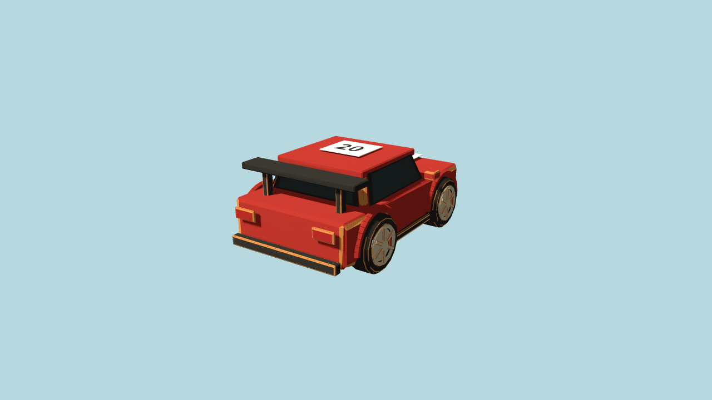 |
| 赛车前侧 | 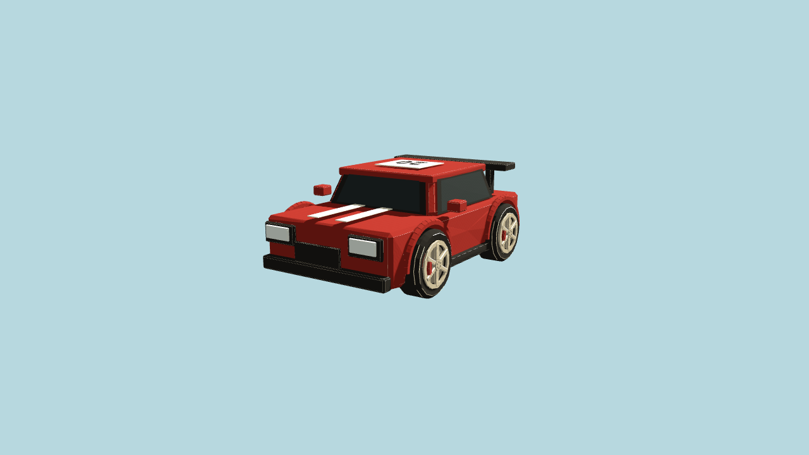 | 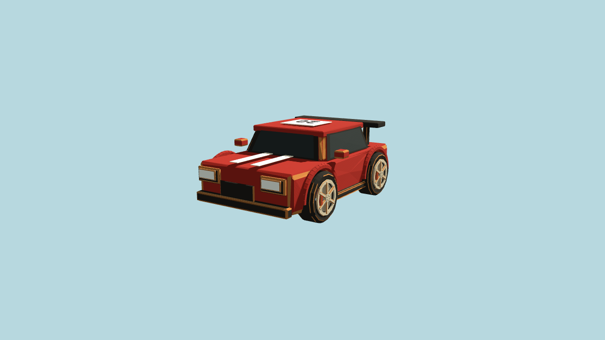 |
| 建筑屋顶与门窗 | 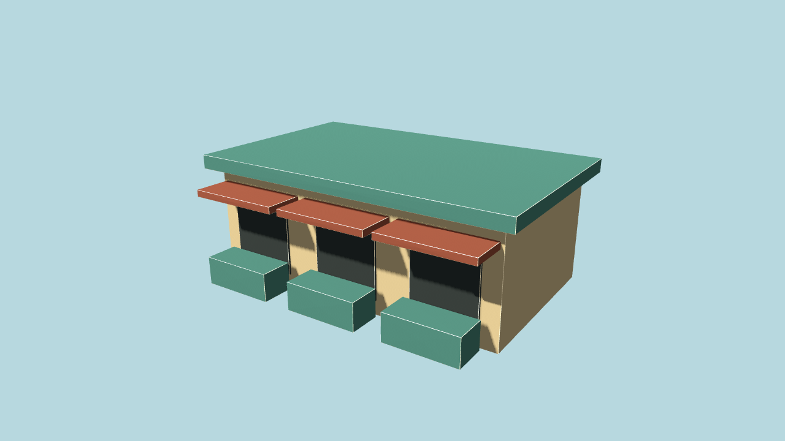 | 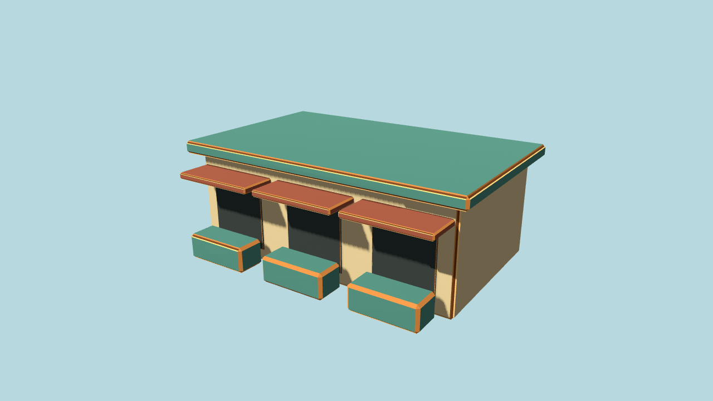 |
| 叶簇 | 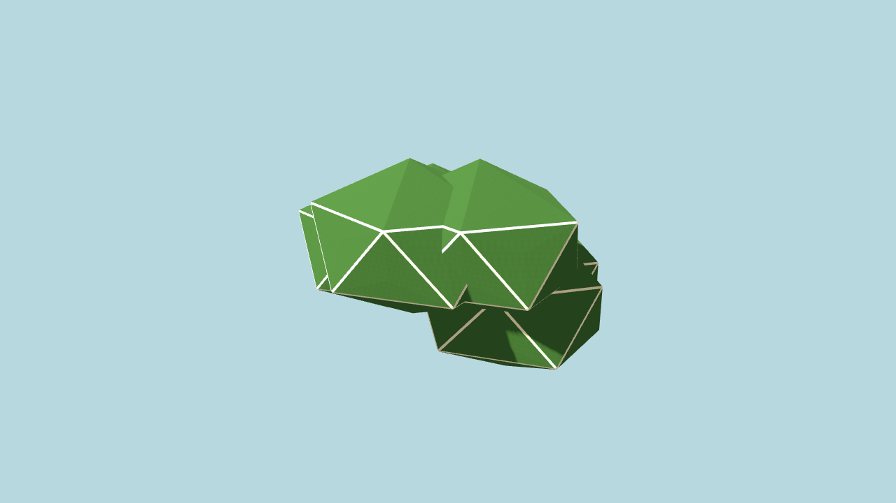 | 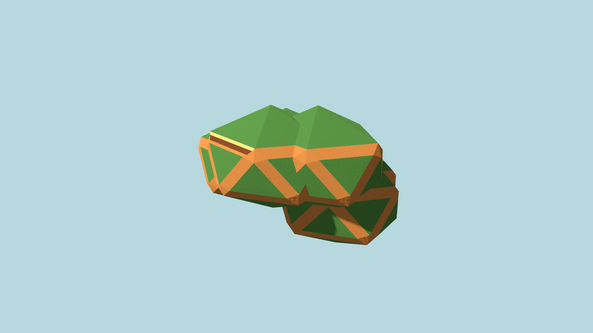 |
| 草丛 | 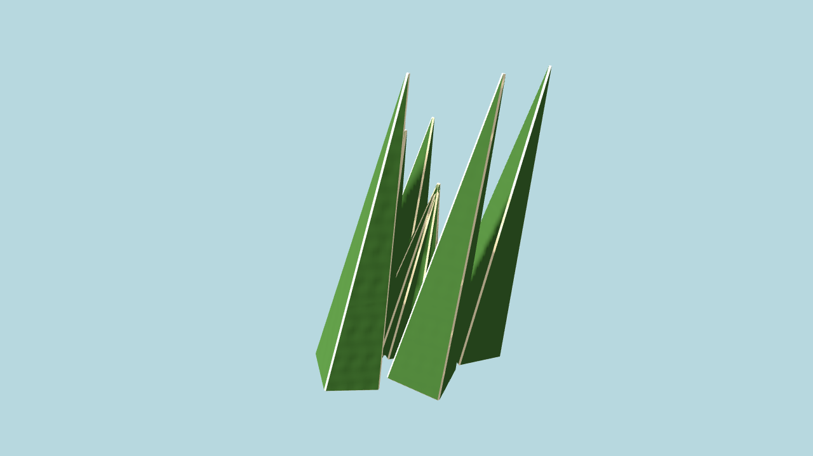 | 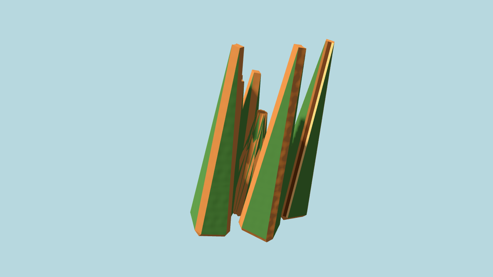 |
| 摩天轮 | 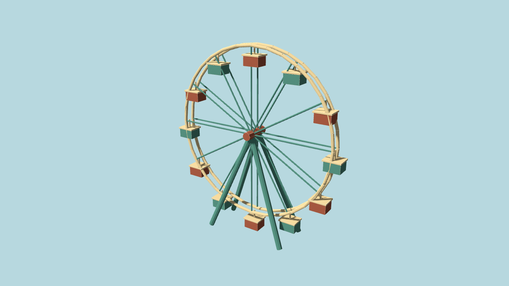 |  |
| 路面板 | 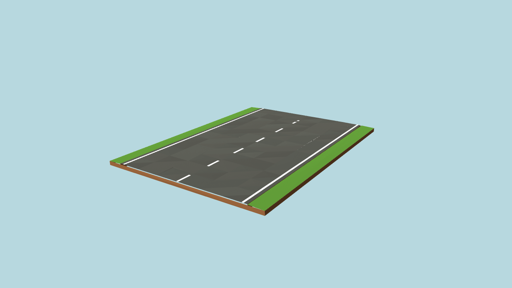 | 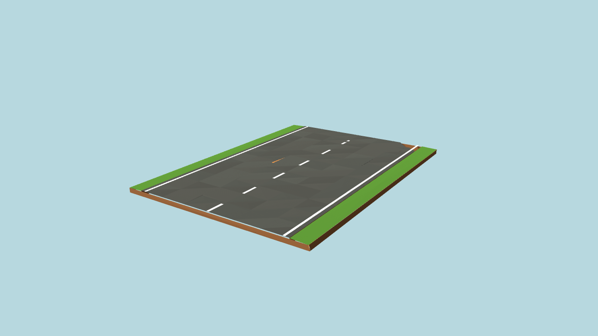 |
| 游戏中后侧近景 |  | 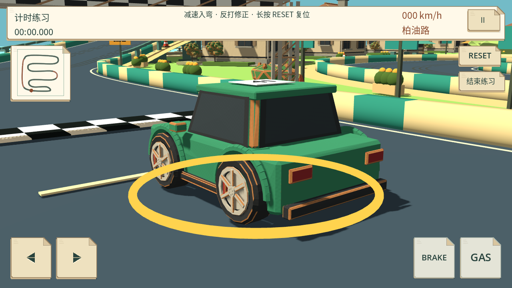 |
| 游戏中前侧近景 |  | 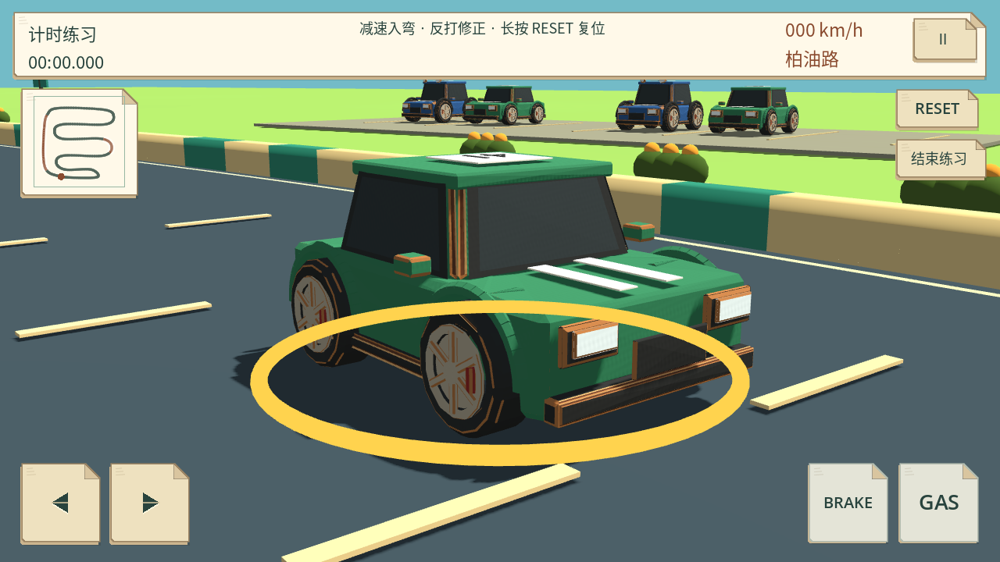 |

全部三风格前后共 60 张控制图在 `build/validation/cardboard/`，另有制作样板。`tools/render_cardboard.gd -- after` 可重拍当前选定风格。

## 风格隔离与性能代理

原版与 bright_clay 的 158 个资源文件哈希完全相同，没有改它们的模型或配色。20 张控制图中 19 张逐像素相同；原版一张近景仅 122 像素、最大 2/255 差异，位于海面区域，可能与原版含 TIME 的水面着色器有关；不声称所有图完全一致。应用运行时代码、碰撞、输入、UI、倒计时、震动、插值和灯光均未修改。

纸模源网格总面数 283904 → 226686（-20.15%）。排除了细小、风险或不可读的重复切边，减少无用面；厚度来自更宽的有效切边和有凹入的层压面，不靠堆叠全模型。37 个均保留原面数上限，道具／植被仍小于 10000 面。

相同相机的所有 10 个采样视图 draw calls 一致。游戏普通视角图元 575213→535953；两个近景 781205→711991、254387→232435。个别小资产近景图元增加，例如市场大厅 1984→3328；不因此宣称所有场景或 Android 都提速。这些是桌面绘制代理计数，不是手机 FPS、帧时间、温升或功耗。

## 验证与未测

Python 44 项通过，包含全部 37 个最终 GLB 的非共面接缝、封闭部件保护、材质／清单／预算，以及原有高饱和橡皮泥数据验证。三风格完整回归各 31 个 suite 正常退出（合计 93 个），模型契约、十赛道、方向／碰撞、插值、倒计时／震动、移动 UI 与产品流程均通过。三份 PCK 各 37 模型可加载，12 组环境隔离、30 次赛道初始化通过。PCK 大小：original 65,820,656、bright_clay 29,415,488、paper_craft 26,886,168 字节；不是 APK 大小。几何、颜料与模型清单的 7 个 Python case 已接入现有构建 workflow；本轮未触发远端 CI。可选长期 `--balance` 未运行。

无 Android 真机或模拟器，实际手机观感、性能和用户视觉验收未完成。无 push、APK、Release、标签或历史修改。沿用既有截图工具退出时的 ObjectDB 清理警告；未重试旧 Library 401／artifact 403。截图只保存在工作区与本地文档，不把工具查看算作原生附件交付。
