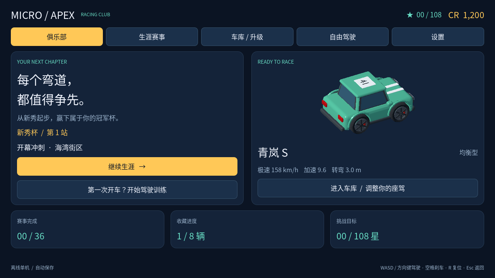
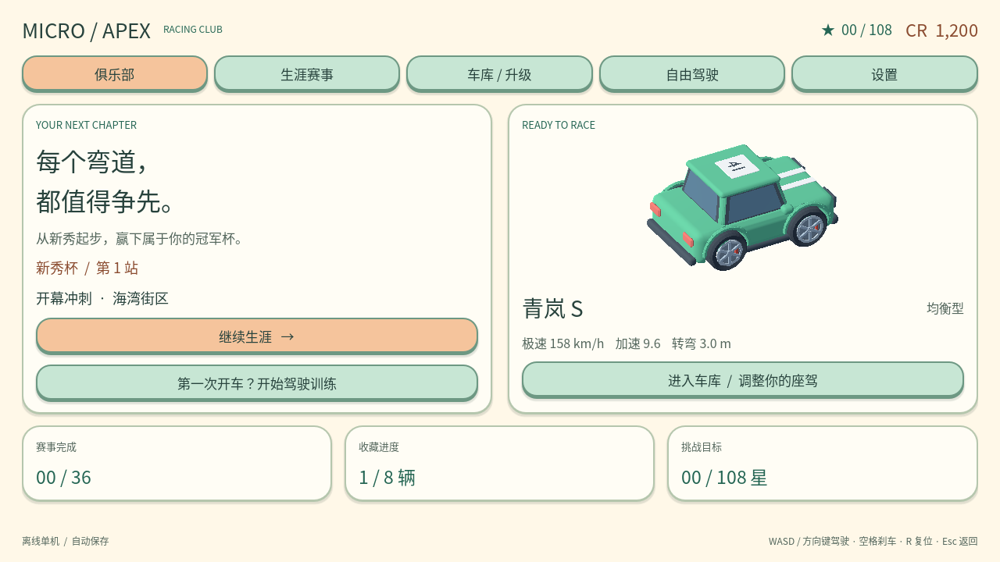
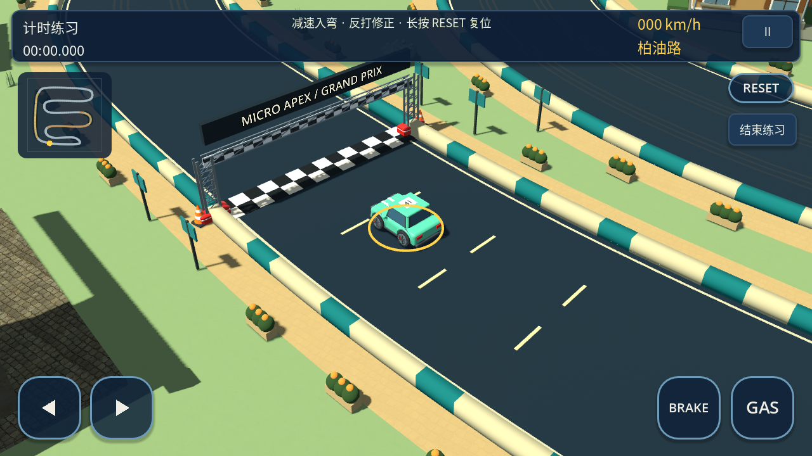
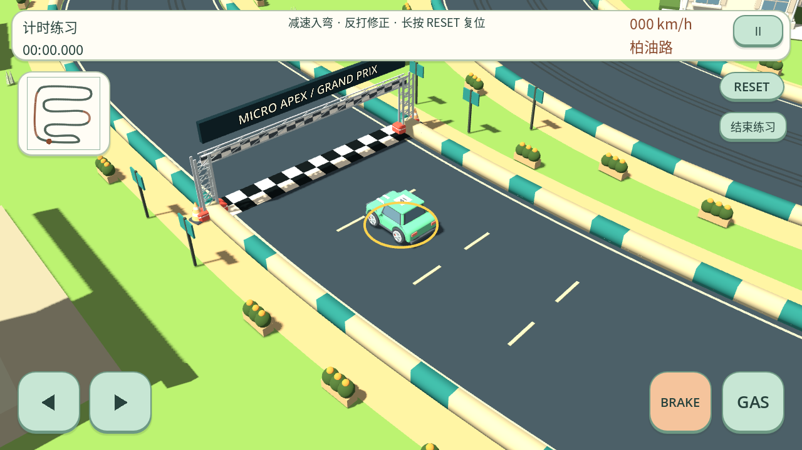
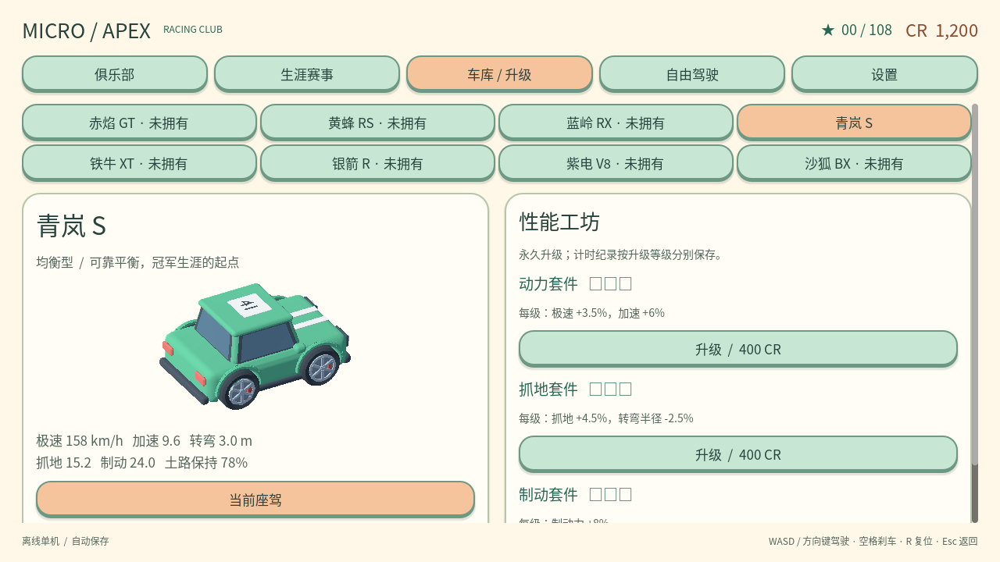
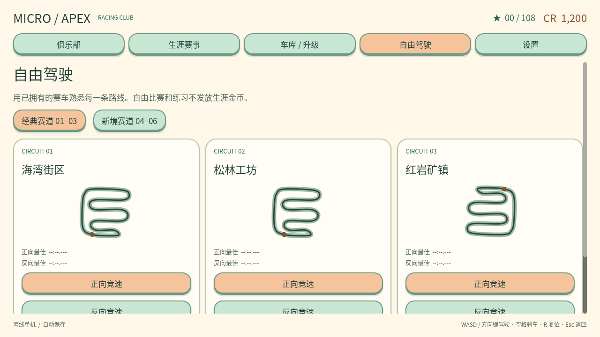
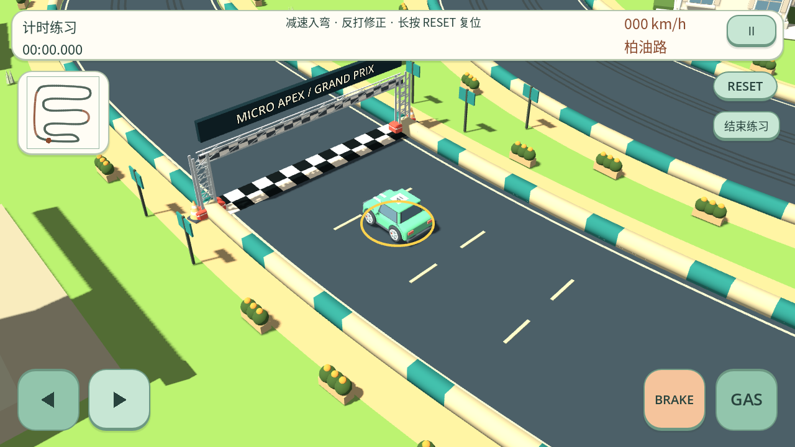
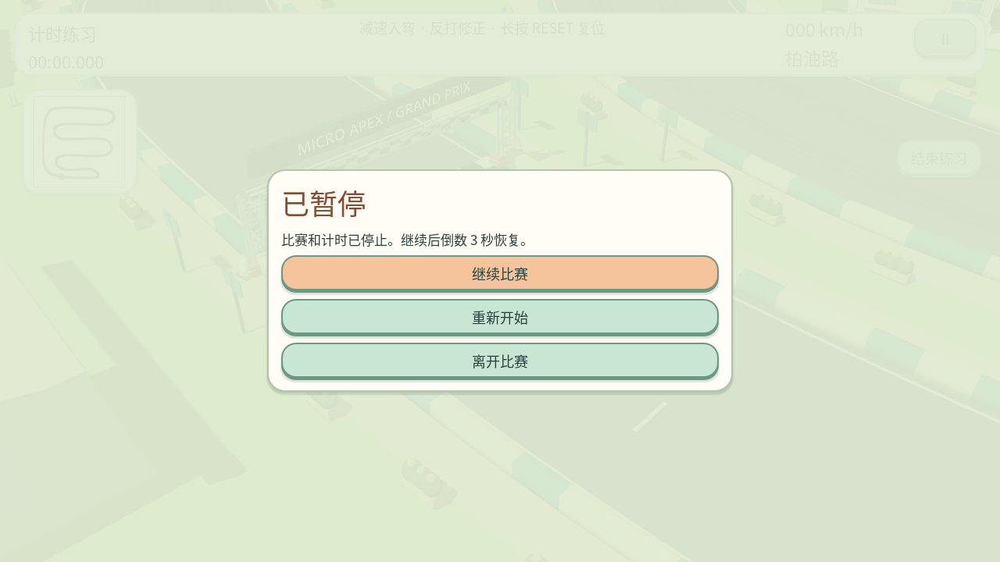
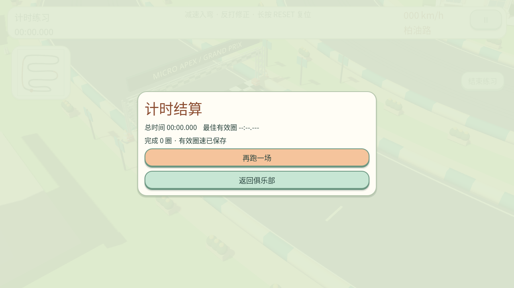

# bright_clay UI

> 本页记录初版明亮主题。当前候选的手捏 A / 折纸 C 几何化 UI 与真实样板见 [A/C 改造](crafted-styles.md)，交互仍沿用本页同一逻辑。

`bright_clay` 使用与模型对应的明亮黏土界面；`original` 沿用原界面。没有增加游戏内风格开关，Android 仍从打包锁定的 ModelStyle 配置读取，桌面开发沿用同名环境变量。

样式集中在 `scripts/clay_ui.gd`，主界面、Frontend、触控绘制和小地图使用同一组颜色与 StyleBox。导航、按钮回调、输入动作和驾驶代码继续共享，场景资源扩充另见 [同步布景](scenery-additions.md)。

- 奶油色背景、暖白圆角卡片、薄荷色按钮及桃色选中/主操作按钮，配深绿正文、棕色强调文字。
- 按钮通过较厚底边和单个小阴影产生厚度；按压时底边变薄、上边变厚，禁用时去掉阴影并降低饱和度，焦点保留明显边框。
- 覆盖俱乐部首页、生涯、车库/升级、自由驾驶/赛道选择、设置/说明、比赛 HUD、倒数、触控转向/GAS/BRAKE/RESET、小地图、暂停和结算。
- 保持触控区域坐标、最小 48 像素按钮、安全区处理与输入语义；不扩大比赛 HUD 或把新面板放入驾驶区。
- 触控与小地图绘制复用缓存样式，不逐帧分配 StyleBox；不增加图片资源、实时模糊或额外 UI 节点层。

## 验证与真实截图

`tests/ui_theme.gd` 检查界面、按钮状态、对比度、实际点击导航/暂停/继续/结算返回，以及双指 LEFT + GAS。按钮正常、按压和禁用状态的文字对比度至少 4.5:1。原版样式保留检查同时运行；既有输入链、产品完整流程和物理插值回归另行覆盖。

`tools/render_ui_samples.gd` 在 1280×720 工程运行中截取关键页面。原版 UI 首轮九张受控截图与本次 UI 改动前逐像素一致（最大误差 0）；比较结果为 `build/validation/ui/original-pixel-comparison.json`。菜单内容渐入完成后截图，比赛画面冻结用于检查样式，不代替实际驾驶验收。

```sh
MICRO_APEX_MODEL_STYLE=bright_clay godot --path . --script tools/render_ui_samples.gd --audio-driver Dummy -- bright-clay
```

包内六赛道探针还检查实际 HUD 的颜色与锁定模型风格一致。当前没有 Android 真机，未验证手机字体观感、真实安全区及 GPU 帧时间。图片保存为本地文件，不将工具显示视为已向用户交付；本轮没有推送、远端构建或 Release。

## 小样

| 原版 | 明亮黏土 |
| --- | --- |
|  |  |
|  |  |

| 黏土车库 | 黏土赛道选择 |
| --- | --- |
|  |  |

| 左转＋GAS 按压 | 暂停 | 结算 |
| --- | --- | --- |
|  |  |  |

## 本轮结果

- UI 专项：original 90 项、bright_clay 325 项通过；包括 960×540 横屏布局、大按钮设置和实际事件点击/多指输入。字体状态对比度检查通过。
- 两风格输入链各 412 项、产品完整流程各 19 项、物理插值各 11 项通过。插值专项按原测试规定使用 `--fixed-fps 120`。
- UI 加入后再次导出两种 PCK：original 65,803,404 bytes，bright_clay 24,955,152 bytes。各 37 个模型与六赛道启动成功，包内 HUD 使用对应风格；相反/非法环境变量均不能覆盖锁定配置。
- 1280×720 软件 OpenGL 采样中，两风格九个画面的绘制调用计数相同：首页 65、车库 80、赛道选择 98、生涯 97、设置 63、HUD/按压 850、暂停 858、结算 864。完整计数在 `build/validation/ui/render-metrics.json`；不代表 Android FPS。
- 新主题没有新纹理或模糊效果。无 Android 设备，仍需手机安装、真实安全区和运行性能复测。
