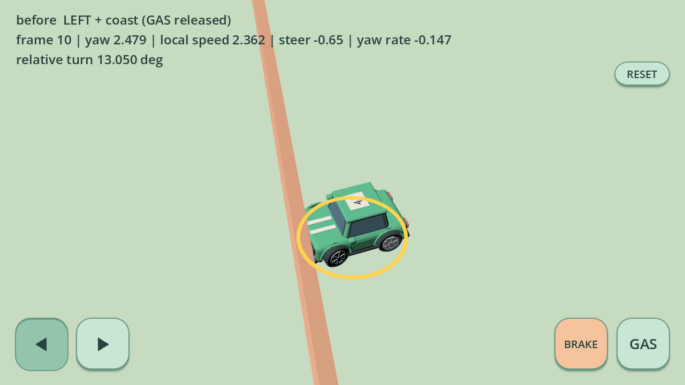
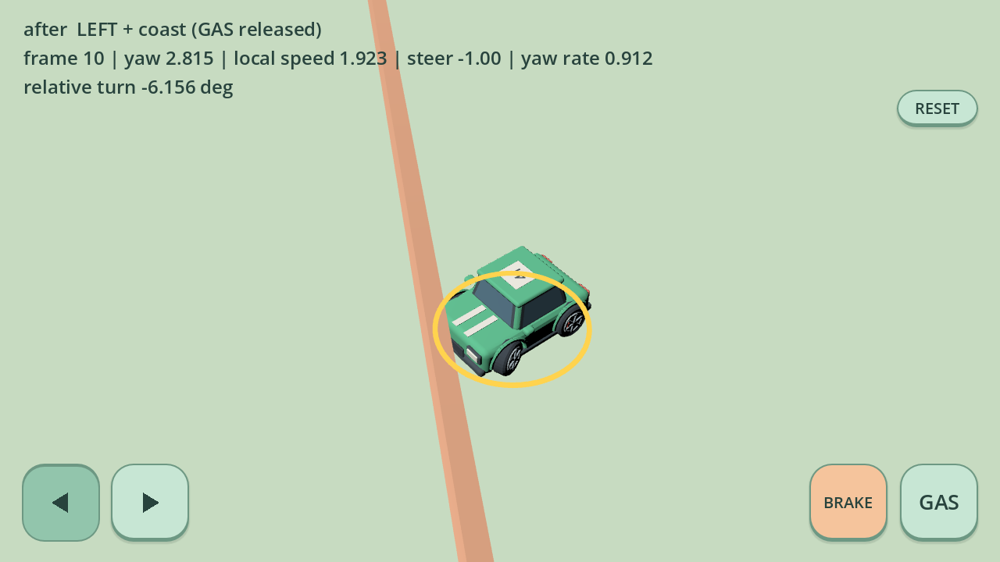

# 碰撞后松油门、反方向输入的转向恢复

基于 0.13.6 源码 `9a71b62dfb883451c20b7242ee0359bcb0a26671` 本地调查。用户报告黏土 Android 包碰撞后仍有左右翻转，且 GAS 并非一直按；具体手机安装版本未核实。以下是 Godot 4.7 本地真实物理与输入复现，不代表 Android 真机验收。

## 根因证据

现有左右箭头语义是车头自身向左/向右转动，前进、BRAKE 倒车与向后滑行均如此。`vehicle_dynamics.gd` 已使用纵向速度绝对值计算转向请求；此次没有修改此规则，也没有按屏幕方向或 yaw 特例翻转符号。

此前护栏修复仍在：迎面硬停且入射速度超过 0.35 时清除旧 `steering` 和 `yaw_rate`。但擦碰/侧滑没有完全硬停，速度被投影和摩擦削减时，两层转向滤波还保留之前的方向。碰撞后的新箭头先要跨过旧的平滑转向，再等待旧旋转速度反向；松开 GAS 并不能清除这些状态。

在真实 `InputEventScreenTouch → Controls.driving → RaceCar.tick → move_and_slide` 链中，先实际右转加速 28 帧，松开 GAS，接触护栏后松右、按左，复现累计向旧右侧转动 **13.05°**。这段记录的纵向速度一直为正，因此不能把它归因为反向速度触发转向反号。

| 左键、GAS 已松开 | 首帧 | 第 6 帧 | 第 11 帧 |
| --- | ---: | ---: | ---: |
| 修复前平滑转向 | +0.85 | +0.10 | −0.65 |
| 修复前旋转速度 rad/s | −2.045 | −1.389 | −0.147 |
| 修复前累计旧方向旋转 | +1.953° | +10.216° | +13.050° |
| 修复后累计旋转 | −0.055° | −1.999° | −6.156° |

这里累计正角表示继续旧右转，负角表示新左转。heading、纵/横速度、原始输入、平滑输入、yaw rate、逐帧转角和碰撞法线保存在 `build/validation/collision-steering/`。可视复现使用真实车辆模型、护栏物理与触控绘制，固定相机截图：

| 修复前 | 修复后 |
| --- | --- |
|  |  |

补测发现，仅使用 0.25 秒计时仍会在等待约 1 秒后再次起步时残留约 **0.94°** 旧方向转动。因此最终实现同时检查自由移动距离，补测后该情况也为 0°。

## 有限恢复范围

玩家发生真实碰撞后，至少保留 0.25 秒恢复期，并要求离开接触后实际移动一个碰撞车身长度（3.4 米）才结束。停在原地或仍贴墙时不会仅因计时结束而失去保护。恢复期间只清除与当前非零箭头相反的平滑转向/旋转状态，然后继续原有滤波。接触连续发生时刷新窗口；相同方向的转向、无方向输入的滑行、无碰撞漂移及所有驾驶参数不变。AI 不应用此方向恢复。

车辆间碰撞给对方施加推力时也通知被推玩家，因为被推车辆可能先分离，自己的下一次 `move_and_slide` 不一定再报告该接触。恢复窗口在时间和自由移动距离均满足后结束，复位/重新配置时清除。旧硬停清零修复保留，未修改碰撞投影、摩擦、推力、纵向速度、倒车判定、插值或相机。

车头旋转和车身滑移分别记录；修复不强行清除已有横向滑移。

## 回归

```sh
MICRO_APEX_MODEL_STYLE=original godot --headless --path . --script tests/collision_steering.gd
MICRO_APEX_MODEL_STYLE=bright_clay godot --headless --path . --script tests/collision_steering.gd
python3 tools/validate.py --godot godot
MICRO_APEX_MODEL_STYLE=bright_clay python3 tools/validate.py --godot godot
```

新专项覆盖：

- 自然转向状态后的实际护栏擦碰，松 GAS、松开再按 GAS、持续 GAS；左右输入和多朝向，包括朝下及 ±π 接缝附近。初始 336 个接触用例在修复前均检测到旧方向残留；再加入 14 个等待 1 秒后重新按 GAS 的用例，共 350 个接触用例，修复后最大反向转角为 0°。
- 两车和三车的真实前/后推撞，正纵向速度被推至负值，随后跨零恢复前进。代表记录 `+0.237 → −1.921 m/s`，期间 BRAKE 未按、倒车模式未开启，转向保持新箭头方向。
- 8 辆车的普通自由驾驶、反打、松油门、BRAKE 松开再按进入倒车，与未修改的动力学逐步一致；自由反打保留惯性。复位清除窗口；静止等待不提前解除保护，驶离接触区域后正常结束。
- 专项共 548 项检查；既有护栏、输入链、方向、操控、插值、UI 与两风格资源/赛道回归继续运行，未降低原测试标准。

截图是本地诊断文件，未作为聊天附件交付。上述记录来自发布前的本地修复验证；修复 APK 由 GitHub Actions 构建和上传，供后续真机复测。无 Android 真机，尚不能确认用户设备上的所有碰撞手势都已消除；手机安装版本也仍待核实。

## 最终验证结果

- 最终实现的 original / bright_clay 完整标准回归均成功结束；各新增碰撞专项 548 项、350 个实际护栏接触用例、20 组两/三车推撞，最大旧方向转角 0°。
- 既有护栏 465、实际输入链 412、方向 8910、漂移操控 88、插值 11 项继续通过；UI 原版 90 / 黏土 325、模型契约 542、布景 671 项及每风格三场比赛通过。
- Python 33 项通过，`git diff --check` 无问题。`vehicle_dynamics.gd`、37 模型资源、UI、相机与项目物理配置无改动。
- 完整原始终态日志为 `build/validation/collision-steering/final-full-original.log` 和 `final-full-bright_clay.log`；分套日志保存在同目录 `final-*-suite-logs/`。最后逐帧记录为 `current-original.json`、`current-bright_clay.json`。
