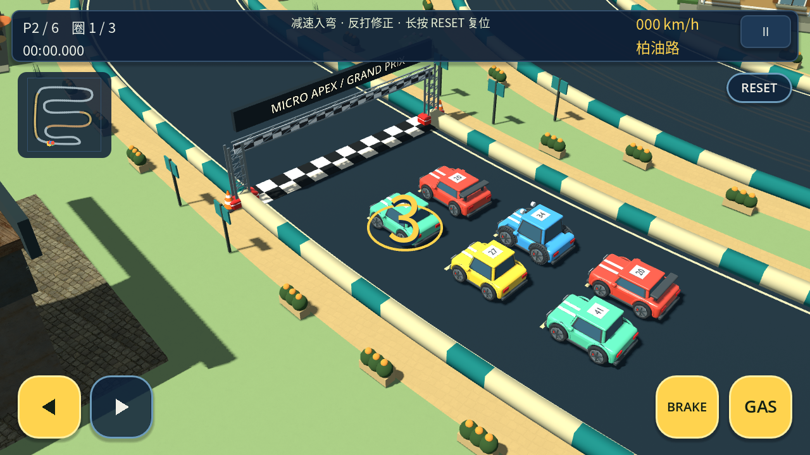
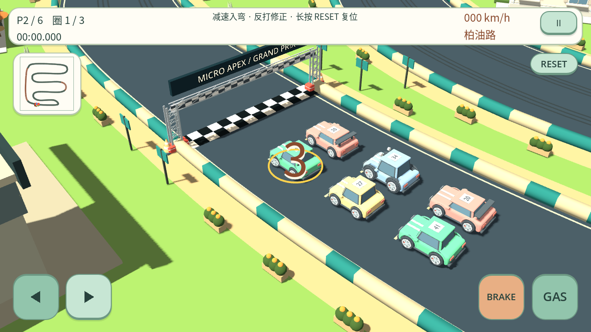

# 倒计时触控与左右触碰区（本地待发布）

基于 0.13.8 源码 `ab4a3a740fa52d11ad4a3ec3c35b546c151cad80`。用户要求倒计时也显示控件、左右可用、油门刹车禁用但可点击触发，以及扩大左右触碰范围。

## 行为

- 初次开赛、暂停恢复的倒计时均显示控件。左右使用原来的平滑轮角响应预摆玩家前轮；车身朝向、位置、线速度、角速度、比赛时间及所有对手保持冻结。
- GAS/BRAKE 可接收按下、松开、多指和按压视觉反馈，但倒计时不输出动力/刹车命令，也不提前驱动车辆或设置倒车档位。自动油门同样被锁住。
- GO 解除动力锁定，不再清空仍按住的手指。持续按压在第一个正常比赛物理步生效；倒计时内点按后已松开、拖出或取消的输入不会排队到开赛。
- 保留既有 GO 时间节拍与动力操作：站定按 BRAKE 在正常比赛步可进入现有倒车驱动，未新增起步、蓄力或自动刹车规则。前进/倒车转向仍遵循 [0.13.8 有符号运动规则](signed-motion-steering.md)。
- 滑出实际触碰区即释放该动作，仍在跟踪的手指可以滑回另一箭头；系统取消会移除该手指。触摸产生的模拟鼠标副本不再另外持有动作，避免取消后留下假按压；真实鼠标仍可用。
- 暂停/失焦清空触摸与鼠标持有状态，恢复是新的锁定倒计时；重新开始创建新的控件，结算禁用并清理触控。

## 实际触碰区

按钮画面、排布、箭头、踏板尺寸和各风格保留。新增独立 `hit_areas`，左右向外扩展按钮尺寸的 24%，在两箭头间隙中线划分，裁剪到可见视口及刹车边界；不覆盖另一个按钮。

1280×720 默认布局，单位为界面坐标（原点左上）：

| 按钮 | 原画面/触碰区 x,y,w,h | 新实际触碰区 x,y,w,h |
| --- | --- | --- |
| 左 | 28,594,100,100 | 4,570,131,148 |
| 右 | 142,594,100,100 | 135,570,131,148 |

默认单个热区面积约为原来的 1.94 倍。大控件画面仍为 126×126，扩展并裁剪后的左/右热区约为 161×182 / 163×182；左右热区相接但不重叠。踏板及 RESET 热区保持原尺寸。窗口缩放后由 Godot 视口换算到实际屏幕坐标，不把虚拟坐标直接当手机像素。

实现将“接受输入/绘制反馈”和“允许踏板发出驾驶命令”分开。倒计时只复用原轮角滤波和轮子显示函数，不执行车辆动力学步；正常比赛的滤波公式、带符号速度规则、抓地、碰撞响应、轮子旋转及物理插值不变。两风格的 37 个模型与资源选择均未更改。

## 验证

在官方 Godot 4.7 stable（5b4e0cb0f）、Linux x86_64 上执行；图形检查使用 Xorg/Mesa llvmpipe Compatibility 软件渲染，物理为 60 Hz。尚无 Android 真机验收。

0.13.8 复现：倒计时 `controls.enabled=false`，实际左触摸未被持有，按钮外 15 单位点不能命中；GO 分支还调用了 `clear()`。修改后输入层保持显示，踏板单独门控，GO 不再清除有效按压。

2026-10-24 结果：两风格完整标准回归全部正常退出并通过，Python 33 项通过。原版完整日志中的早期倒计时专项为 298 项，新增四种比例后另行补跑 418 项通过；黏土整套直接包含最终 418 项。未运行可选 `--balance`、Android 构建或真机测试。

新增 `tests/countdown_controls.gd`：418 项，覆盖可见/启用状态、真实多指/键盘/鼠标事件分发、轮子预摆、全部发车车辆冻结、动力与时间不提前推进、GAS/BRAKE 按住跨 GO、提前释放、滑出/滑回、取消、模拟鼠标去重、自动油门、焦点暂停/恢复、重开、结算清理。

12 个窗口尺寸（各含默认/大控件）：480×270、568×320、640×360、960×540、1280×720、1600×900、1920×1080、2560×1080、1024×768、960×640、1440×720、2340×1080；包含 4:3、3:2、16:9、2:1、19.5:9、21:9。检查热区在屏幕内、包含原按钮、宽高均扩大、互不重叠且不抢踏板/RESET，并向图形外的真实屏幕坐标派发触摸验证命中。

运行入口：

```sh
MICRO_APEX_MODEL_STYLE=original python3 tools/validate.py --godot /path/to/godot-4.7
MICRO_APEX_MODEL_STYLE=bright_clay python3 tools/validate.py --godot /path/to/godot-4.7
python3 -m unittest discover -s tests -p 'test_*.py'
```

完整回归还保留有符号运动 3,106 项、碰撞 736 项、实际护栏 1,302 项、方向 11,406 项、输入链 412 项、物理插值 11 项，以及两套 UI、37 模型、赛道与完整比赛流程。强制跳过倒计时的旧测试夹具同步显式解除踏板锁定，不修改其原来的驾驶断言。

原始日志与六张截图保存在 `build/validation/countdown-controls/`；完整日志为 `full-{style}.log`，扩展窗口比例的原版专项日志为 `original-expanded-aspects.log`，截图日志为 `render-{style}.log`。两风格图形日志均确认：按左+GAS+BRAKE 的倒计时中 speed=0、time=0、动力命令 false；松 BRAKE、保持左+GAS 后首个正常比赛步 speed≈0.16 m/s、time=1/60 s、GAS=true。绘制调用约 1,126→1,128，仅为软件渲染观察，不代表手机帧率。

图形截图成功生成并逐张检查。软件驱动报告不支持切换 VSync，部分黏土截图运行退出时有 6 个 ObjectDB 实例清理警告；详细日志复查未重现，原日志保留。不据此声称完成 Android 帧率、内存或长期稳定性验收。

## 实际画面

两图均为倒计时同时按左、GAS 和 BRAKE 的真实游戏画面；踏板有反馈但车辆与比赛时间仍为零。不是 Android 截图，也不表示图片已通过聊天附件交付。

原版：



黏土版：


