# 倒计时背景板透明度

基于已发布 0.13.12 / `8184ac9`，只调整倒计时背景板绘制，不改变数字／GO 的字号、颜色、6 单位描边、阴影、位置、触控区域、电子音或震动。纳入 0.13.13 三风格 Android 测试发布；真机仍待验收。

| 绘制层 | 原 alpha | 新 alpha |
| --- | ---: | ---: |
| original 填充 | 0.96 | 0.30 |
| original 金边 | 1.00 | 0.50 |
| original 阴影 | 0.25 | 0.08 |
| 黏土／纸模填充、底层、边框、折角 | 1.00 | 0.12 |
| 黏土／纸模阴影 | 0.16 | 0.0192 |
| 纸模折线 | 0.45 | 0.054 |
| 纸纤维 | 0.14 | 0.0168 |

工艺 StyleBox 新增默认 1.0 的 `paint_opacity`，在所有多边形及线条颜色进入绘制缓冲时统一乘入。只有倒计时板的独立副本设置为 0.12，共享菜单／HUD／触控样式维持 1.0。未降低父节点或文字节点的 modulate。多层 alpha 叠加后的最终遮挡不等于单层 0.12，底层和纸张折角也已一起变透明。

## 同场景实际渲染

Godot 4.7 / Linux Mesa 软件 OpenGL，同一固定起步位置、车辆和相机，画面停止物理与时间更新。明亮雪地赛道、调暗灯光的海湾赛道及 2400×1080 宽屏，分别拍摄 3、GO 与隐藏提示板的对照；共 54 张 PNG。

三风格、三个场景中，修改前后的“隐藏板”对照图逐像素完全相同，确认世界及其他 UI 未变。避开数字与边缘的板内侧带，相对无板画面的 RGB 色差中位数降至原值的：original 37.2%–37.5%、黏土 13.3%–16.0%、纸模 19.7%–22.8%。这是受控像素遮挡代理指标，不是 alpha 或手机可读性的测量。

### 明亮场景，数字 3

| 风格 | 修改前 | 修改后 |
| --- | --- | --- |
| original | 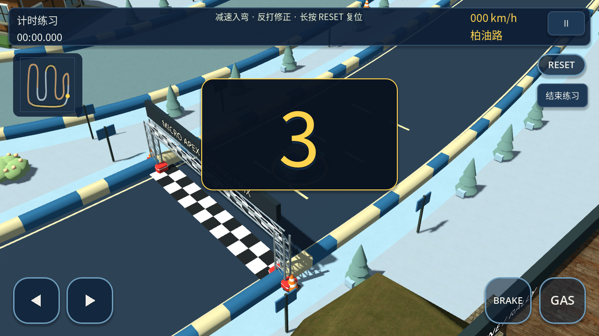 | 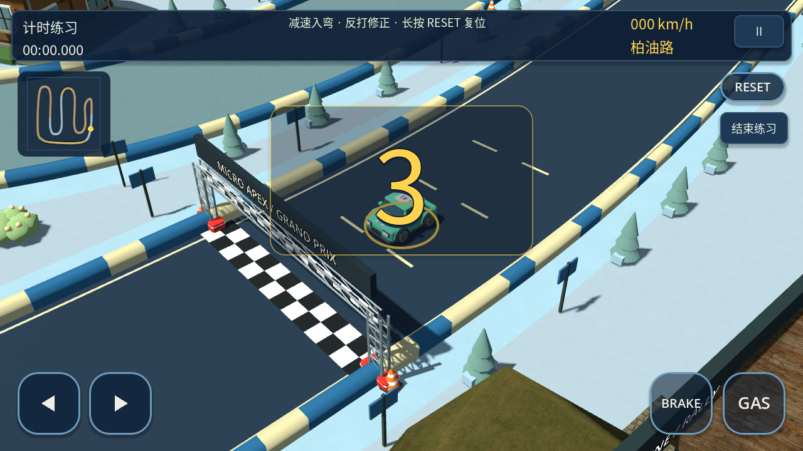 |
| bright_clay | 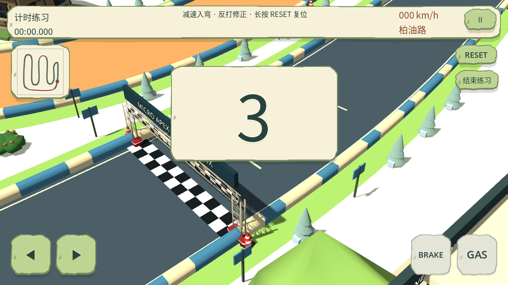 | 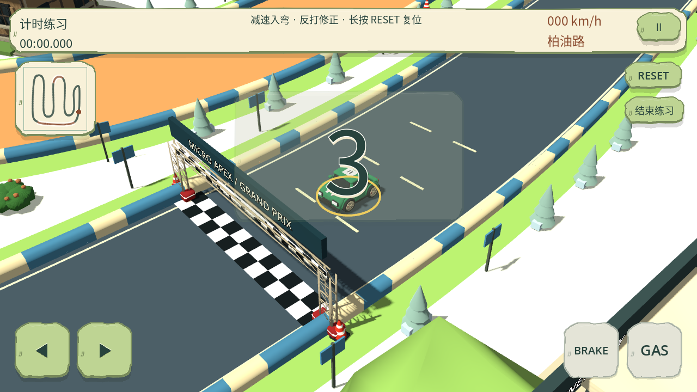 |
| paper_craft | 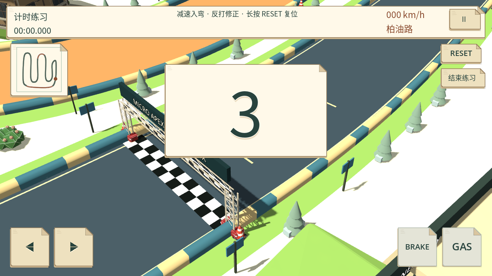 | 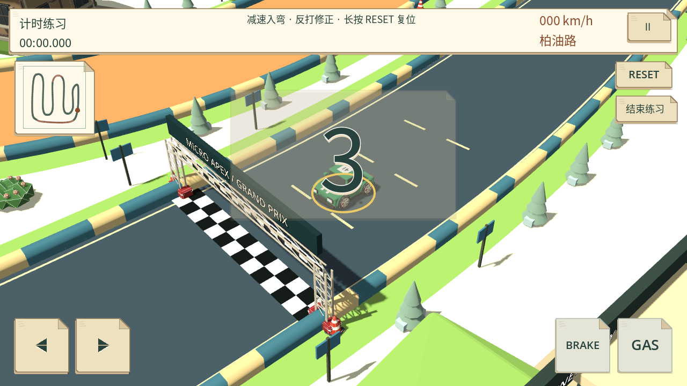 |

### 暗场景与宽屏 GO

| 风格 | 暗场景 | 宽屏 |
| --- | --- | --- |
| original | 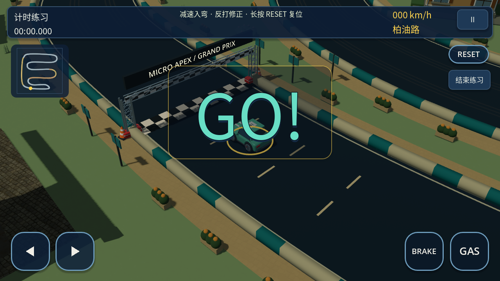 | 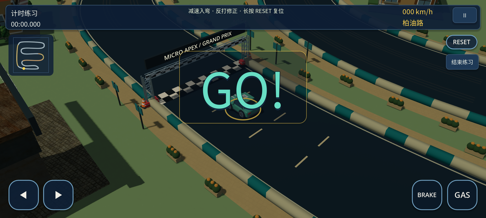 |
| bright_clay | 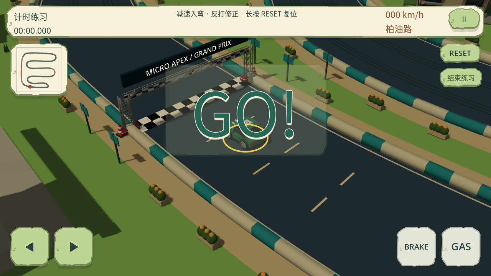 | 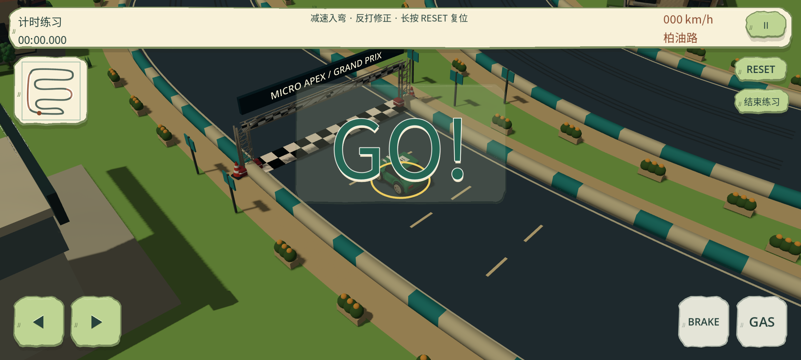 |
| paper_craft | 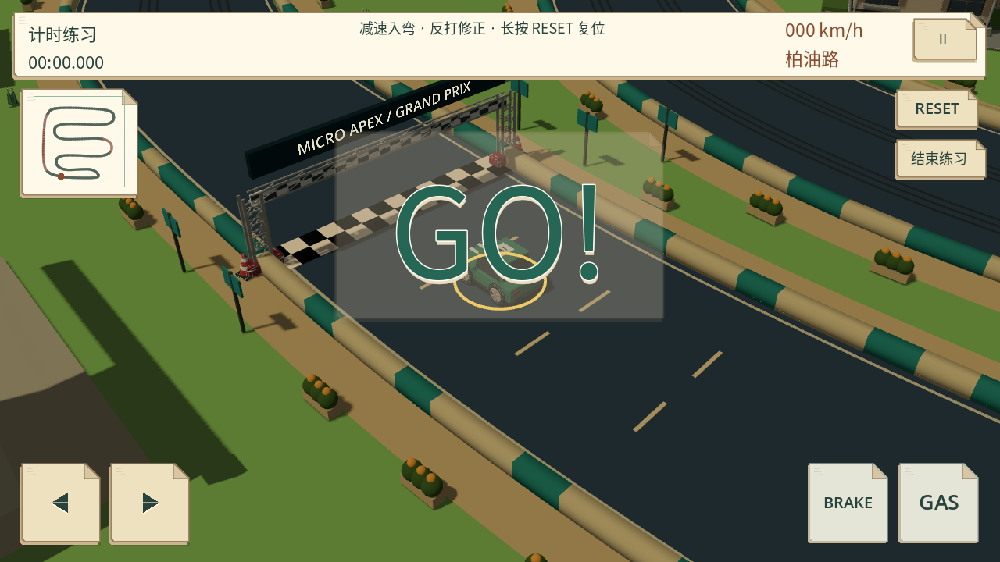 | 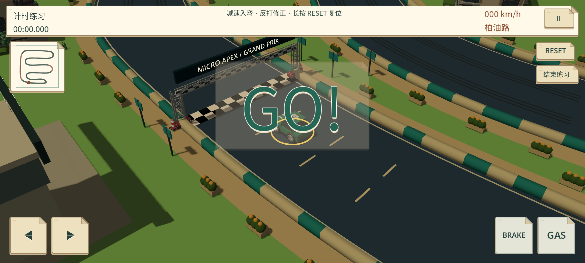 |

所有原始前／后／无板 PNG 在 `build/validation/countdown-opacity/`；同目录 `pixels.json` 保存对照测量。用 `MICRO_APEX_MODEL_STYLE=<style> godot --path . --script res://tools/render_countdown_opacity.gd -- after` 重拍当前版本；before 需在修改前源码执行，同次渲染记录的世界和相机不变。

## 验证

三套各 38 项倒计时专项通过，包含独立文字透明度、原版背景／边框／阴影 alpha、工艺板独立副本与共享菜单保持不透明，以及既有电子音、冻结、重开、恢复和宽屏触控避让。Python 38 项通过。三风格完整回归各 30 个套件正常结束（合计 90 个），包括十赛道比赛、37 模型契约、572 项移动 UI、418 项原倒计时操作、转向、插值、碰撞、生涯及产品流程。可选长期 `--balance` 未运行；日志与 `verified.json` 同目录。

无 Android 真机，本轮为桌面实际渲染与模拟输入验证，不代表手机屏幕亮度、阳光下可读性或真机性能验收。修改前渲染首轮尝试 ALSA 时因无声卡初始化失败，自动回退 Dummy 后正常出图；修改后显式使用 Dummy。渲染工具退出沿用既有 ObjectDB 清理警告；无运行时脚本错误。未重试 Library 401 或 artifact 403。
