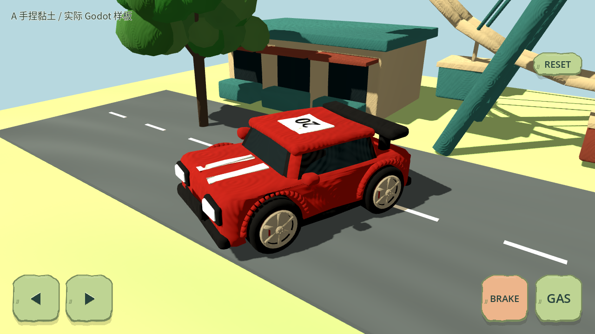
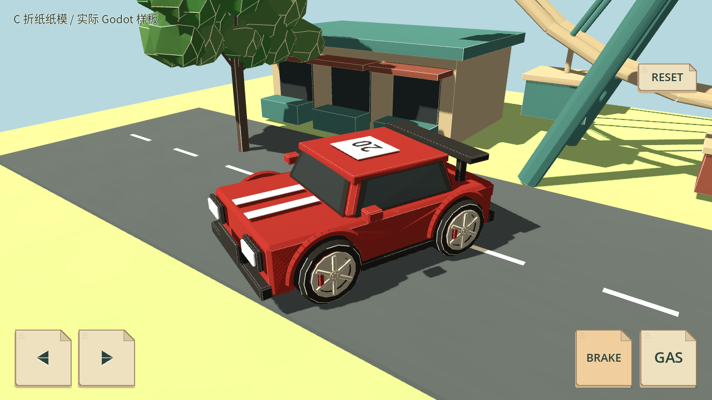
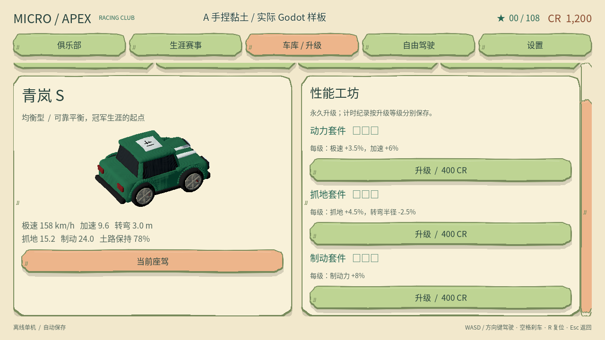
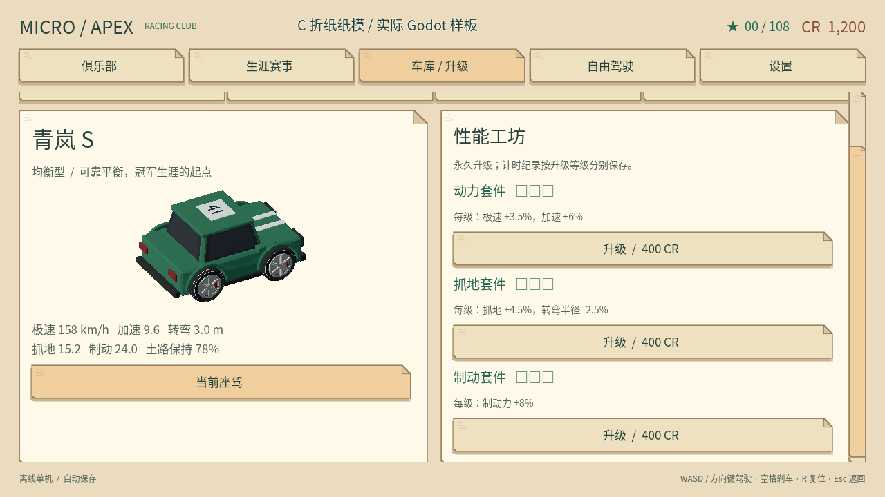

# 手捏黏土 A 与折纸纸模 C

本地候选，尚未推送或打包发布。原版模型、UI、车辆运动学和赛道布置保留；先完成的手机滚动/横屏/安全区修复是独立提交 `9d6943a`。

三种构建选择：`original`、`bright_clay`（兼容旧值，现在是 A 手捏风格）、`paper_craft`（C 折纸风格）。每种均对应同一套 37 个语义模型，没有游戏内切换。

## 实际渲染样板

以下是 Godot 4.7 的同位置真实渲染，不是概念参考图。车辆保持原有低车顶比例、四轮枢轴和精确包围盒。

| A 手捏黏土 | C 折纸纸模 |
| --- | --- |
|  |  |
|  |  |

A：几何轻微不规则起伏、圆润法线、烘焙指印凹凸，低高光哑光表面；界面是厚实起伏边缘、压印箭头与下压反馈。

C：合并共面三角片后重新折面、薄纸边带和浅折线、稀疏纸纤维，保留颜色辨识；界面采用叠纸层、折角按钮、裁切箭头和纸层按压反馈。

主题集中在 `clay_ui.gd`（历史兼容文件名）和 `craft_box.gd`，菜单/生涯/车库/赛道/设置/许可、HUD、触控、暂停和结算复用同一交互代码。装饰仅绘制，不创建拦截触摸的控件。滚动条仍预留实际 24 单位宽度，倒计时和驾驶热区不变。

## 资源与移动成本

`tools/build_crafted_models.py` 使用 Blender 4.3+ 从未改动的原版 GLB 生成两个独立目录。它保留全部节点路径、原始 TRS、轮子枢轴与每个网格的包围盒。当前三套 GLB 均没有烘焙动画或骨骼；轮子沿原枢轴由既有运行时代码驱动。JSON manifest 记录来源/产物 SHA-256、面数和字节数，完整生成才标记 `complete=true`。旧入口 `build_bright_clay.py` 转调新生成器。

每个模型共享一个不透明顶点色材质，每种风格共享一张 128×128 法线图；没有透明树叶、实时模糊或额外碰撞。Godot 导入钩子把顶点色标志烘焙进导入材质，避免单 surface glTF 在 4.7 中首次读取没有启用顶点色的问题；游戏不运行导入工具。

大型模型面数上限为原始 2.6 倍加 64；低面数植被允许最多 1500 面，以容纳纸边和折面，但仍受所有新增资产每件少于 10000 面的既有限制。摩天轮不再细分长边，保留约 5500 面。UI 不规则面合并提交、描线批量提交，避免每根装饰线独立 draw call。

桌面软件 OpenGL 样板计数：原版车库 82 calls，A 85，C 84；静态场景原版 136，A/C 约 97（合并材质降低 surface 数），但几何图元增多。只用于成本代理，不能视作 Android FPS、功耗、温升或真机验收。

原版以独立 UI 修复提交 `9d6943a` 的实际渲染为基线；9 张主菜单、车库、自由驾驶、生涯、设置、HUD、按压、暂停与结算截图逐像素一致。原版 GLB 也未修改。

完整模型契约 2669 项通过，覆盖三个目录、节点/原始 TRS、精确包围盒、四轮枢轴、真实顶点颜料与导入标志、共享法线、材质不透明、几何变化与面数预算。Python 检查 36 项通过。

本地三份 PCK 的实际字节数为 original 64,802,016、bright_clay 28,342,576、paper_craft 29,496,232。37 个模型均可从各自包加载；12 组环境隔离检查、18 次包内六赛道启动通过，未选模型和风格法线贴图缺失。PCK 不含 Android native 模板，不能称为 APK 大小。

全赛道远景压力视角（相同相机和画质）：

| 风格 | draw calls | 图元 | 纹理显存计数 |
| --- | ---: | ---: | ---: |
| original | 1705 | 742,160 | 82,444,547 bytes |
| A | 1487 | 545,248 | 26,586,042 bytes |
| C | 1487 | 978,734 | 26,586,042 bytes |

C 的纸边/折面使自动 LOD 保留更多几何，远景图元仍比原版高约 32%，不能声称全面提速。已去掉逐三角形色差，保留连续纸面颜料，让共面区域可简化；原始 C 远景约 108 万图元降到约 98 万。没有因此改变玩法、摆放或摄像机，也没有降低验证阈值。Android 真机需重点观察纸模在较低性能设备上的帧时间与温升。

## 最终本地回归

Godot 4.7 stable，Linux Xorg + Mesa llvmpipe 实际渲染；完整验证于三种风格分别正常退出。每套 23 项标准 Godot suite 全通过（另有导入检查），合计 69 项 suite，包含各三场整场比赛。关键项每套：手机布局/触摸 562、倒计时 418、运动转向 3106、碰撞转向 736、模型契约 2669、物理插值 11、方向专项 11406、相机 5202。两种工艺 UI 各 327 项检查通过；原版 91 项通过。

Python 36 项全部通过；PCK、实际渲染与原版像素对照见上。未运行可选 `--balance` 长期平衡检查；没有 Android 真机/模拟器，未构建 APK、未推送或发布。不把软件 OpenGL 计数等同于 Android 实测。

验证日志：`build/validation/style-study/full-{original,bright_clay,paper_craft}.log`，逐项日志在 `suite-logs-<style>/`，资源包记录在 `export-details/`；可审查补丁为 `review.patch`。这些是本地忽略产物，文档与截图副本随源码提交。

## 重建与验证

```sh
blender -b -t 2 --python-exit-code 1 --python tools/build_crafted_models.py -- --style bright_clay
blender -b -t 2 --python-exit-code 1 --python tools/build_crafted_models.py -- --style paper_craft
godot --headless --editor --import
python3 -m unittest discover -s tests -p 'test_*.py'
MICRO_APEX_MODEL_STYLE=paper_craft python3 tools/validate.py --godot godot
python3 tools/verify_model_style_exports.py --godot godot
```

最后一项仅导出三份 Android 资源 PCK，不生成 APK、不调用远端。检查每包 37 模型、其余两套缺失、包内风格与 UI 锁定、所有六赛道启动；相反和非法环境变量不能覆盖包内选择。生成前的 partial manifest 会阻止打包。

Library 官方批量保存 helper 在工具发现阶段返回 HTTP 401，未返回文件 ID；不把工具图片输出算作已交付。本地原图保留在 `build/validation/style-study/`，文档截图保留可审查副本。没有 Android 设备，本轮不声称解决了真机美术或性能验收。
