# 单片厚纸板草丛（本地候选）

这些改动已纳入 0.13.15 `paper_craft` 发布源码；本页保留各阶段的本地验证记录。可安装包与实际发布状态以 [GitHub Releases](https://github.com/lseyesl/godot_car_micro_apex/releases) 和对应 Actions 为准，Android 真机仍未验收。

按用户要求，`paper_craft` 的 `foliage_grass_green`、`foliage_grass_dry` 从独立草叶堆成的立体丛，改为各一片竖立草丛剪影。不是交叉卡片，也不是材质模拟厚度。未推送、打包 APK 或发布。

本页记录草丛改造阶段；随后三种树也改成单片厚板，最新树木改动见 [树木剪影](tree-board.md)。本页“其他模型不变”指草丛这一阶段，不能据此认为树木仍是立体造型。

## 几何和场景

- 两款各用一条 13 点连续轮廓，正反两面之间厚度为 **0.055 个场景单位**。绿色较直立，枯草轮廓略偏斜。
- 切边有三层棕色纸芯面带，中心圈真实凹入。最终 GLB 焊接位置后是一个连通、封闭的实体，无独立草叶、交叉面、透明贴片或新增碰撞体。
- 保留原语义 key、节点层级、枢轴、宽度约 0.703 和顶部高度约 0.995。厚度由旧包围盒约 0.580 收窄至 0.055；底部落到场景地面顶面 -0.08，不再保留旧模型悬空的约 0.030 底边。模型契约只对这两个纸模明确检查这些新尺寸，其他模型仍按旧包围盒严格校验。
- 十条赛道的草丛数量、点位、预留半径与驾驶区净空不变。纸模草丛固定朝向游戏相机方位 35.54°，仅加确定性的 ±8°变化，避免薄板随机侧对相机难以辨认。不添加逐帧 billboard；草丛仍是实体静态摆件。
- 其余 35 个纸模、原版和黏土资源保持不变。每款草丛仍一个不透明材质和原有实例化路径。

## 实际渲染对照

Godot 4.7 stable、Blender 4.3.2、Linux Mesa llvmpipe，1280×720 固定灯光／相机。近景从实际赛道草丛点位拍摄；不是概念图，也不是 Android 真机。严格侧面会收窄成厚边，这是单片模型的预期。

| 视图 | 修改前 | 修改后 |
| --- | --- | --- |
| 绿色正面 | 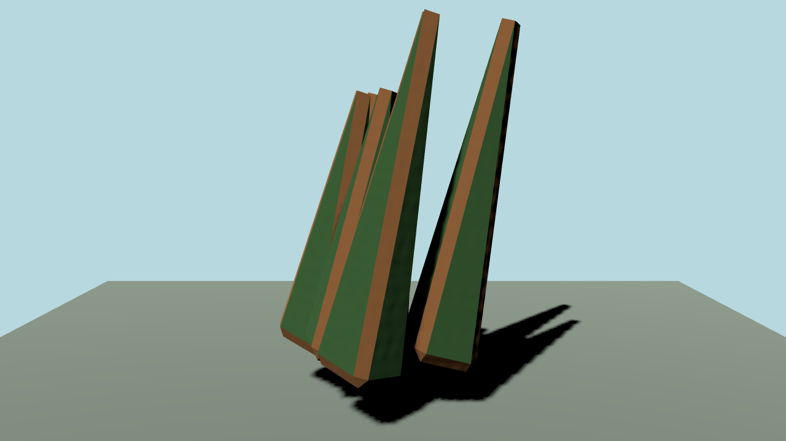 | 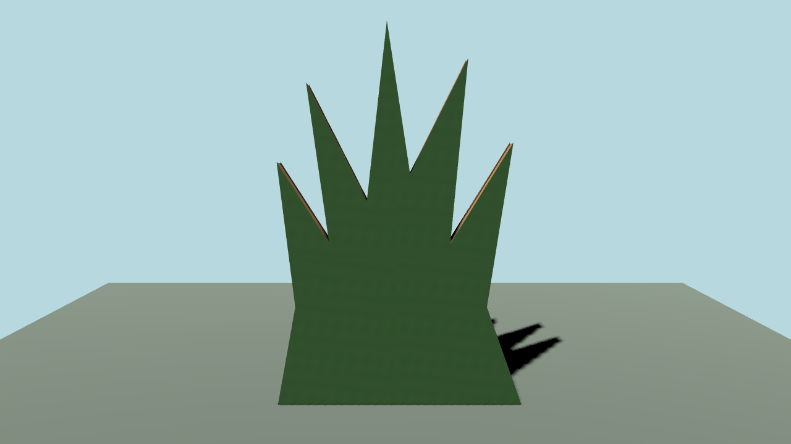 |
| 绿色侧面 | 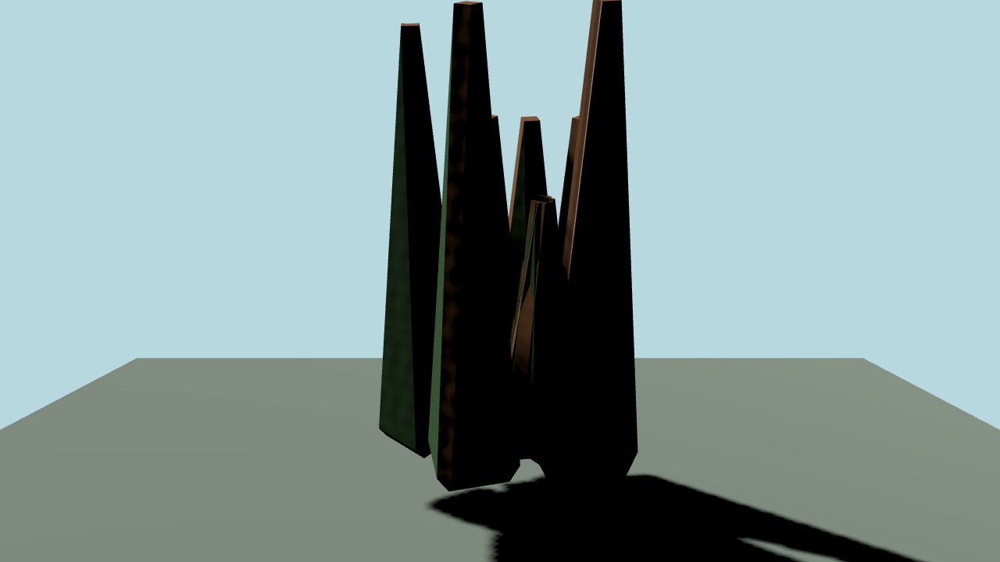 | 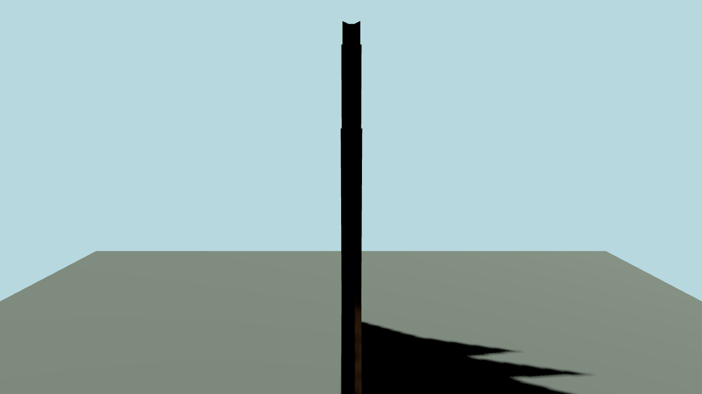 |
| 绿色斜侧 | 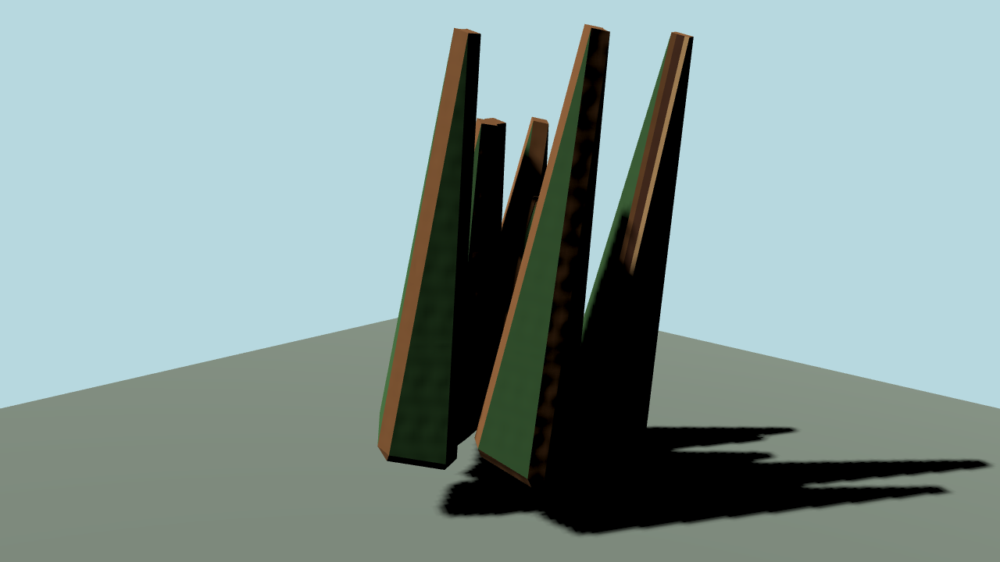 | 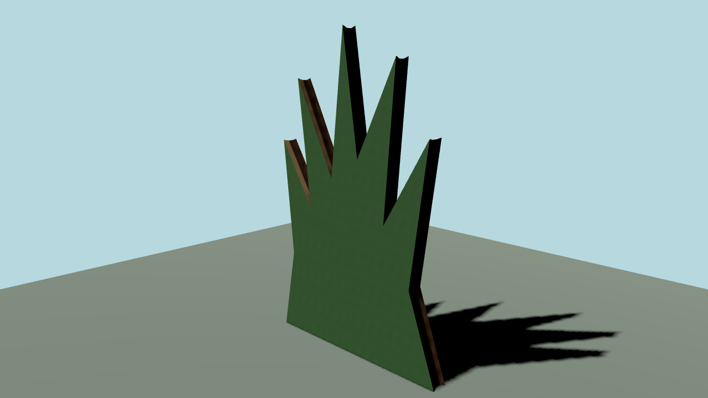 |
| 枯草斜侧 | 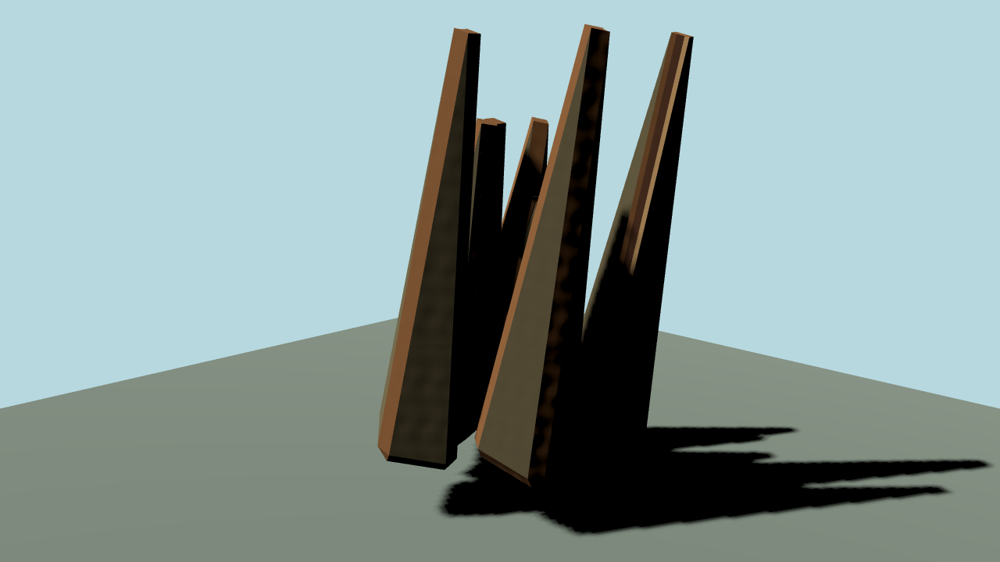 | 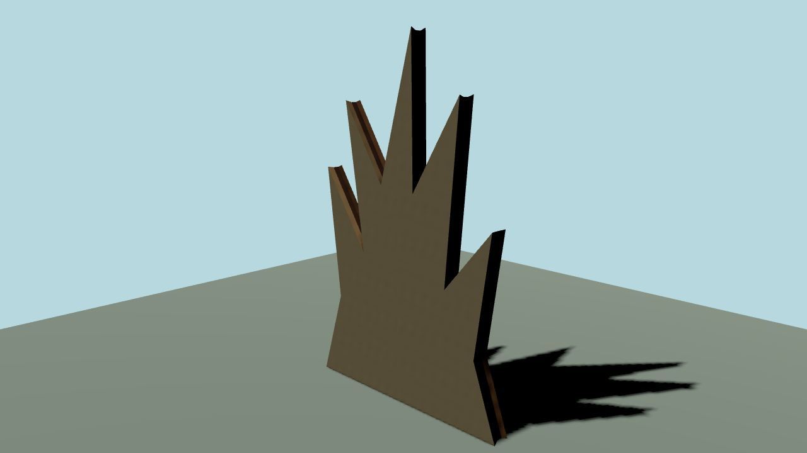 |
| 绿色实际赛道近景 | 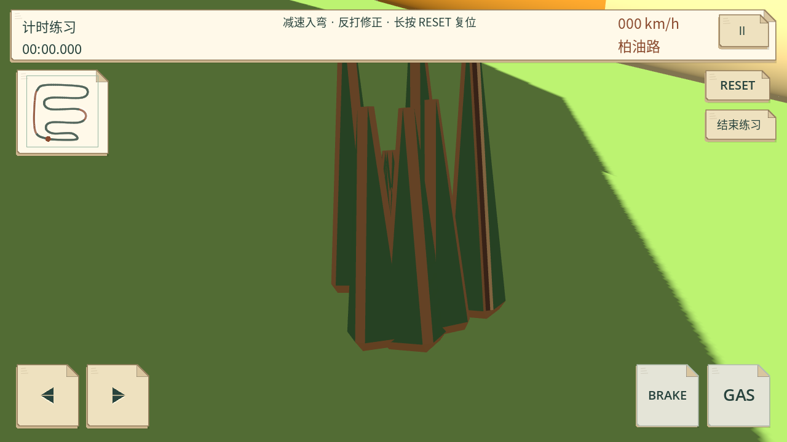 | 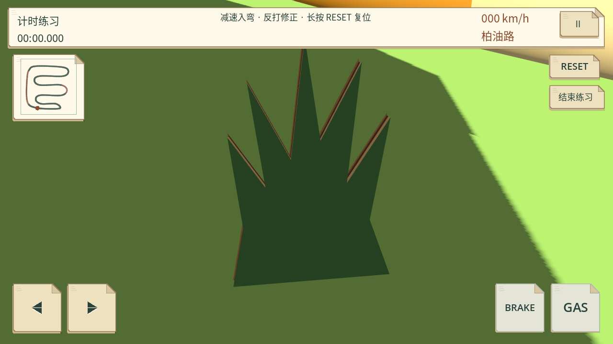 |
| 枯草实际赛道近景 | 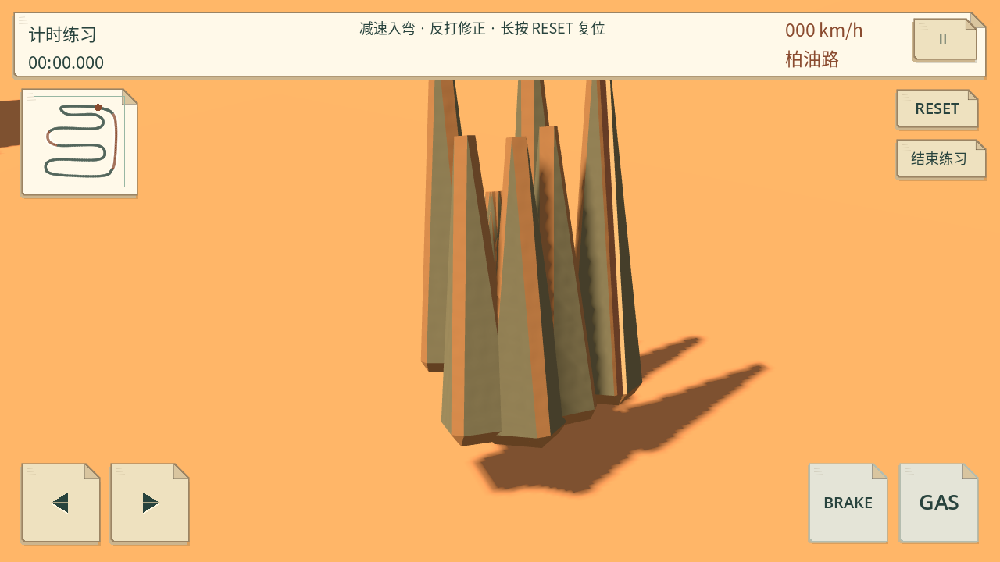 | 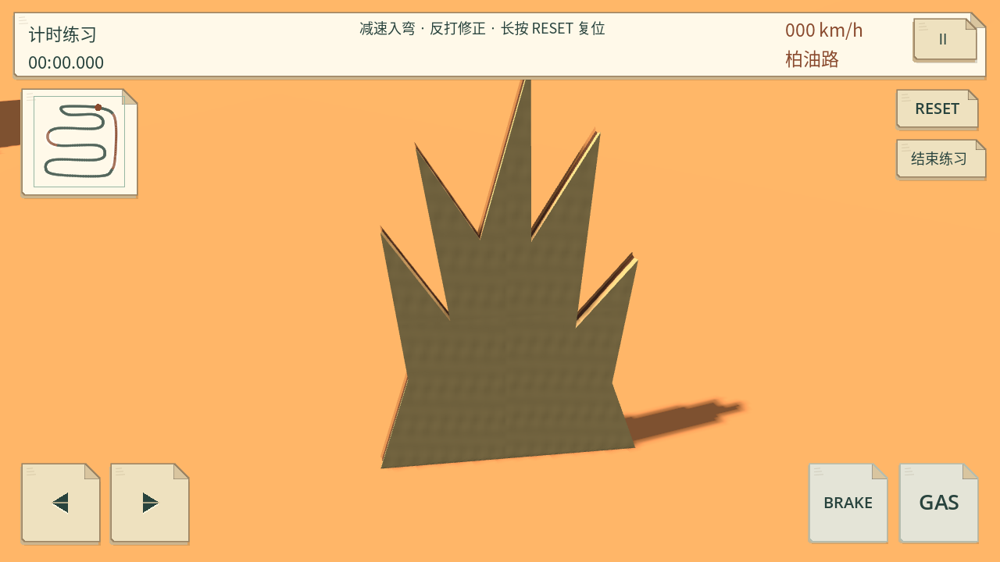 |

全部三风格前后 60 张控制图保存在 `build/validation/grass-board/`；使用 `tools/render_grass_board.gd -- after` 可重拍当前风格。截图在本地文档保存，不能视作已交付会话附件。

## 预算与隔离

两款各 276→100 个三角形（-63.8%）；GLB 分别从 31,472 字节降为绿色 10,348、枯草 10,344 字节。draw calls 在 10 个纸模采样视图中均不变。游戏普通视角示例 602741→601685 个绘制图元；另一场景 254111 保持一致（草丛不在取景内），两个草丛近景分别 196111→195407、123291→122939。计数来自桌面渲染代理，不代表手机 FPS 或温升。

232 个受保护资源文件哈希全部一致，包括原版、黏土和其余 35 个纸模资源；纸模 manifest 只有两款草丛条目变化。原版和黏土前后 20 张控制图逐像素相同。

## 验证

Python 新增从最终 GLB 检查单连通体、所有边双面闭合、四个厚度层、100 面预算、落地底边和不透明颜色。布景检查覆盖十条赛道中实际作者节点的相机朝向、落地高度及数量；实例化前原节点用于验证，因为 headless RenderingServerDummy 不提供 MultiMesh 变换读回，实际 GPU 渲染另行检查。

45 项 Python 检查通过，含新的单板拓扑检查。十赛道纸模布景 1,749 项检查、三风格模型契约各 2,673 项检查通过；三套完整回归各 31 组全部正常退出（合计 93 组），包括方向／碰撞、插值、移动 UI、倒计时／震动与完整产品流程。三份 PCK 各加载 37 模型，12 组环境变量隔离、30 次赛道初始化通过，导出过程恢复原配置。PCK 大小为 original 65,820,864、bright_clay 29,415,696、paper_craft 26,872,408 字节；不是 APK 大小。可选长期 `--balance` 未运行。未接触 Android 真机；手机远景可读性、实际性能和用户视觉验收尚未完成。未重试旧 Library 401 或 artifact 403，也未修改其他模型配色、碰撞、车辆操控、UI 或音效。
