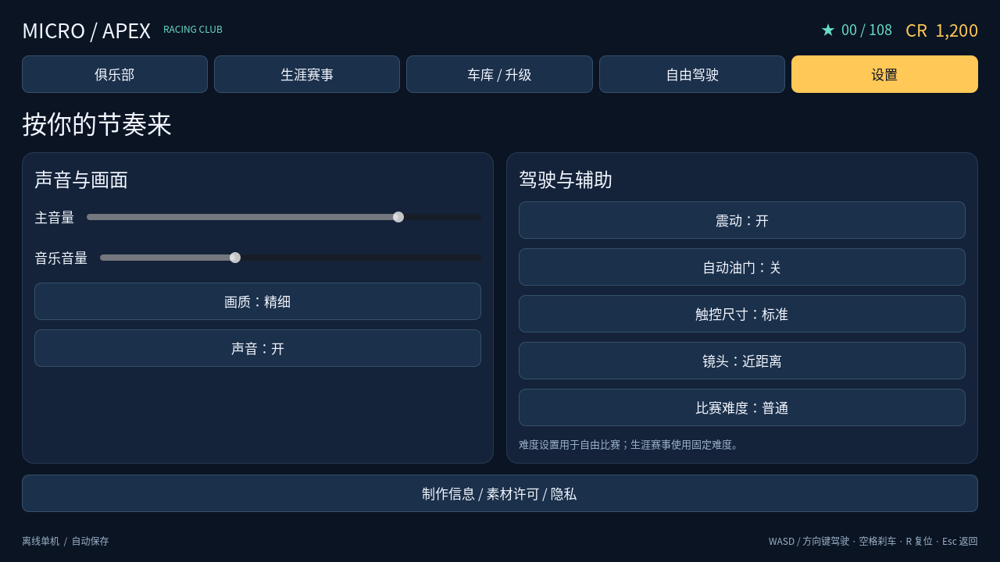
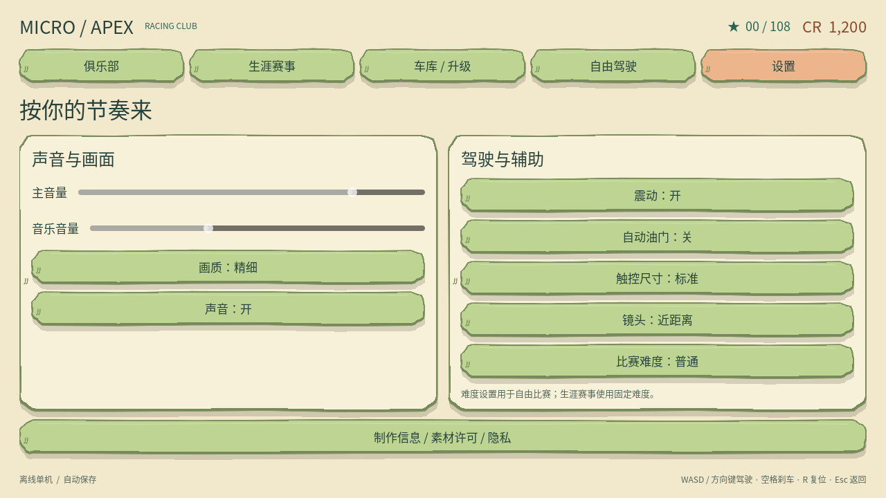
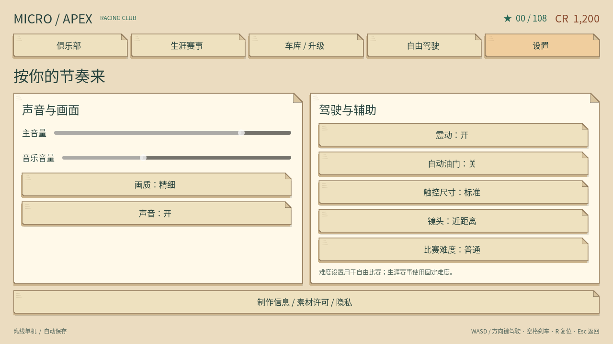

# 手机震动反馈

本地实现基于 Godot 4.7；与声音／静音开关独立。设置 → 驾驶与辅助 → **震动：开／关**，默认开启。旧存档缺少 `settings.vibration` 时也开启；修改通过现有原子存档流程持久保存，保存失败不会改变实际开关。

## 触发规则

| 场景 | 弱 | 中 | 强 |
| --- | --- | --- | --- |
| 玩家与其他车辆碰撞 | 40 ms / 0.40 | 65 ms / 0.65 | 90 ms / 0.90 |
| 玩家与护栏／实体静态障碍碰撞 | 25 ms / 0.25 | 45 ms / 0.45 | 65 ms / 0.65 |

表中为时长／请求幅度。按碰撞法线方向的接近速度分级：小于 2.5 m/s 不触发；[2.5, 5) 弱；[5, 10) 中；≥10 强。车辆碰撞用玩家与对车的相对速度，既覆盖玩家撞车，也覆盖 AI 撞玩家。使用 `move_and_slide()` 的实际接触与对方碰撞速度，不读取撞击音效的 `impact` 状态。AI 互撞不发玩家事件。接触法线 `abs(y) >= 0.5` 的支撑／地面接触被排除，普通贴地行驶不会作为道路撞击。

每个物理帧先汇总全部车辆报告，选择接近速度最大的接触，只发一个脉冲，不累加多接触点；相同速度优先车辆类别。所有反馈共享 300 ms 冷却。连续接触只允许起始一次，必须连续至少 180 ms 没有相关接触后，新的碰撞才有资格触发；擦墙和冷却期间的接触不会积攒延迟震动。

真实比赛倒计时首次切换到 GO 时发 **35 ms / 0.40**，与同一帧 GO 视觉／电子音切换一起请求。每次新比赛一次；恢复比赛的提示不会再次触发。关闭震动时跳过这次请求，不在重新打开时补发。

菜单、结算、暂停、退后台、失焦和退出均停止新请求；恢复比赛不重置 GO 标记，重开比赛重置标记和接触历史。没有额外的按钮、漂移、油门、刹车或结算震动。

## 平台与限制

生产代码仅在 Android／iOS 调用 [Input.vibrate_handheld](https://docs.godotengine.org/en/stable/classes/class_input.html#class-input-method-vibrate-handheld)，桌面等平台不操作设备。两个现有 Android 导出预设均增加正常的 `permissions/vibrate=true`，不引入插件、额外权限或凭据。该设置使后续 Android 导出包含 VIBRATE；0.13.12 发布流程会再核验实际 Release APK manifest。

幅度是请求值，实际振感取决于硬件／系统；没有幅度控制的设备不能保证强度区别，因此各级同时采用不同的时长。没有振动器时不会产生物理反馈。参见 Android [Vibrator](https://developer.android.com/reference/android/os/Vibrator) 与 [VIBRATE permission](https://developer.android.com/reference/android/Manifest.permission#VIBRATE)。

Godot 4.7 没有公开的手持设备取消震动 API；不能用零时长／零幅度假装取消：官方 [Java wrapper](https://github.com/godotengine/godot/blob/4.7-stable/platform/android/java_godot_wrapper.cpp) 将零幅度夹为最小非零值，[Android bridge](https://github.com/godotengine/godot/blob/4.7-stable/platform/android/java/lib/src/main/java/org/godotengine/godot/nativeapi/GodotNativeBridge.kt) 忽略非正时长。本实现不循环、不排队，关闭／暂停等只阻止新请求，已经发出的脉冲可能持续到自身结束（最多 90 ms）。

## 验证与真实预览

- Godot 4.7 Linux headless：三风格各自完整回归 29 个套件通过；最终补充的 `haptics` 25 项与 `haptic_contacts` 6 项在三风格分别通过。验证入口现已包含这两个套件，共 30 个默认套件。
- 专项覆盖默认／旧存档／保存／关闭、GO 一次及静音独立、暂停恢复、后台、阈值／全部碰撞等级、冷却／擦碰、多接触汇总、真实车撞车／AI 撞玩家／AI 互撞、实体墙体与实际地面接触，以及桌面不调用设备。
- 已检查三风格 1280×720 设置页实际 Godot OpenGL 渲染。最终移动 UI 专项三风格各 572 项通过，包括实际触摸震动开关、低高度、宽屏、安全区和触摸滚动；Python 38 项测试通过。原有转向、插值、倒计时操作、十赛道与模型契约测试继续通过。
- 未接 Android 真机，未验证实际振感、振动延迟、无振动器设备与 Android 生命周期的硬件表现；桌面注入记录只验证请求与规则。本地验证记录不代表 Android 真机验收；0.13.12 包另经 Actions 构建及发布检查。

| 原版 | 手捏黏土 | 纸模 |
| --- | --- | --- |
|  |  |  |
