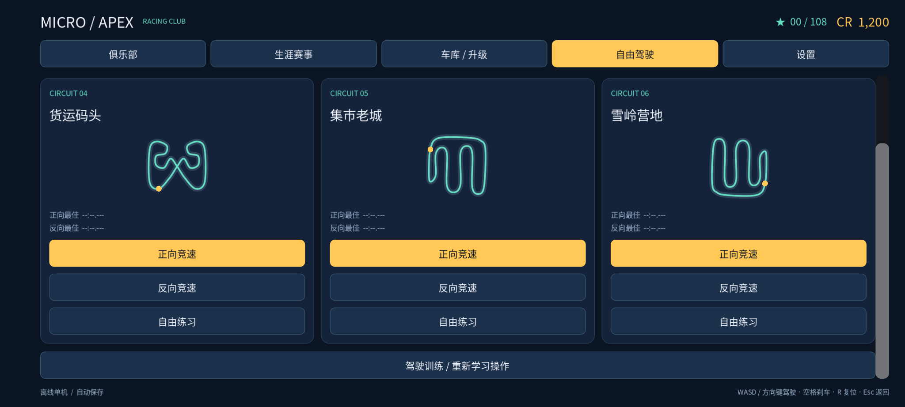
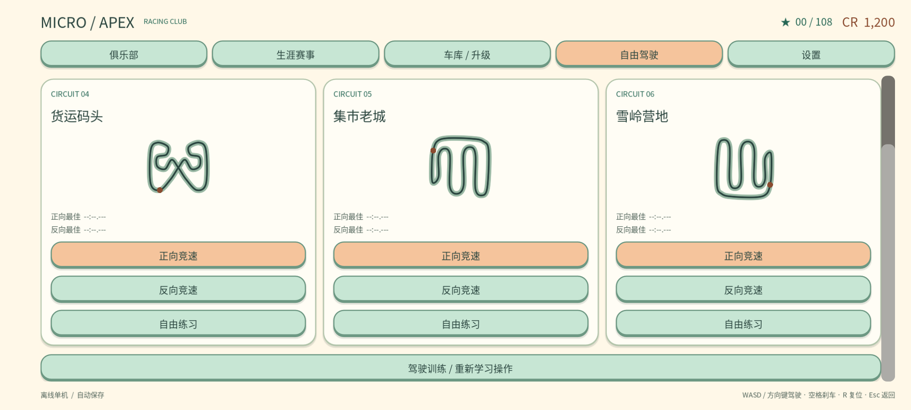

# Android 菜单滚动、宽屏和底部内容修复（本地待发布）

基于已发布 0.13.9 源码 `c04928f5c7c2e6617911e8eedca98259f9bbd4d2`。用户手机实际安装版本、型号、系统栏模式尚未确认。三张手机 JPEG 已通过 Library 正式流程下载并实际查看，原图只保留在忽略的本地验证目录，没有加入仓库或重新上传。

## 截图与复现证据

三图均为现有黏土 UI：车库/升级、自由驾驶“新境赛道”、生涯赛事。图片尺寸为 2048×922，不能据此断言手机的原生分辨率。车库最下方制动升级、自由驾驶的反向/练习按钮、生涯第二行详情按钮被滚动窗口下沿截住；页脚仍完整，不能把这些截图简单解释成系统裁掉整个屏幕底部。两侧约 205 像素黑柱之外，左侧还有约 55 像素蓝绿色边带，属于不同层级的现象。

1. 工程未显式设置 stretch aspect，采用 KEEP。在 2400×1080 实际窗口上测得画布 1280×720、缩放 1.5、原点 (240,0)，即左右各 240 像素留白；与手机截图比例一致。
2. 卡片 `PanelContainer` 默认 `MOUSE_FILTER_STOP`。实际事件路由表明，落在卡片内部的触摸和模拟鼠标事件都没有到达父 ScrollContainer；落在车库两列间隙则能到达并滚动。这解释了“有时空隙可滑、卡片上滑不动”的差别。按钮也需允许父滚动区接收手势。
3. 在 Godot 4.7 的触屏能力模拟下派发真实 ScreenTouch/ScreenDrag：修复前生涯/自由驾驶从卡片滑动后仍为 0；事件传递修复后分别达到底部 24/158，车库为 87 个界面单位。
4. 原生滚动条主题最小宽度只有 8。ScrollContainer 依据主题最小宽度预留空间，仅改 `custom_minimum_size` 并不能可靠扩展内容边距，因此同时扩展主题最小宽度和真实条形几何。

## 修改

- 卡片和按钮向父滚动区传递指针事件，继续使用 Godot 原生滚动与 `NOTIFICATION_SCROLL_BEGIN` 取消按钮点击，避免滑动误触购买、发车或导航。设置页滑块可纵向带动父滚动区，手势超过滚动死区时恢复按下前的值；横向拖动仍调整音量。
- 12 单位滚动死区，24 单位真实滚动条宽度；原有按钮尺寸、文案、玩法动作与双风格配色保留。
- `canvas_items` 配合 `aspect=expand`，画布扩展到窗口宽高比，不再固定 16:9 居中留黑。不会把宽屏画面横向拉伸成固定分辨率。
- 菜单背景独立铺满整个画布；交互 UI 留在安全区内，避免刘海/挖孔的安全边距露出背后的蓝绿色 3D 背景。
- 安全区先与实际窗口的屏幕坐标矩形求交，再换算到画布；已被系统栏缩小的窗口不重复扣减同一边距。无效安全区不把 UI 压成零。窗口尺寸变化及返回前台会刷新安全区。
- 弹窗外层也有有界滚动区，短安全区下可以到达底部关闭/确认按钮；许可文字保留独立内层滚动。

未改车辆动力学、前进/倒车转向、物理插值、0.13.9 倒计时输入、扩大的左右热区、赛道布局或任何模型资源。本次仅修复功能与适配，不包含后续美术风格改造。

## 验证

使用官方 Godot 4.7 stable（5b4e0cb0f）、Linux x86_64。2026-10-24 最终结果：original 与 bright_clay 两套完整标准验证均正常退出并全部通过，Python 33 项通过；未运行可选 `--balance`，未做 Android 打包或真机验收。

专项 `tests/mobile_ui_layout.gd` 共 562 项，向引擎派发真实触摸事件，通过原生 ScrollContainer 执行滚动，而不是只断言属性。桌面/Headless 的触屏能力开关只在测试进程内开启，项目仍保留原有鼠标/触摸模拟设置。

- 2048×922、2400×1080、2560×1080、960×432、1280×720、1024×768；每种均测试无边距和模拟侧边/顶底系统安全区。
- 六个主要菜单逐页滑到底、验证最下方可用按钮完整可见并真实点按一次；同时检查滑动不触发按钮、第二根手指不造成误操作、滚动条可真实拖动。
- 滑块横向调整、纵向滚动恢复原值；许可嵌套滚动及短安全区的关闭按钮；页面切换后输入不遗留。
- 安全区换算包括窗口已有系统边距、超出窗口、空值；比赛中使用偏移后的真实坐标验证左+GAS 双指、倒计时门控、GO 延续及松开。
- 完整标准验证还包含 418 项倒计时、3,106 项有符号转向、736 项碰撞、1,302 项真实护栏、11,406 项方向、412 项输入、11 项插值、双风格 UI/37 模型、赛道与整场比赛。Python 单元测试 33 项。相机取景扩为 5,202 项：明确 16:9、手机宽屏和 4:3 三种窗口，保留原有取景阈值。

首轮相机测试隐含使用 Headless 的 64×64 方形窗口；expand 后不再固定为 16:9，出现 43 项取景失败。测试现显式指定三种受支持的横屏窗口并扩为 5,202 项，独立复测全部通过，未改相机参数或放宽阈值。首轮失败保存在 `first-attempt-camera-fixture-failure.log`，两风格完整验证随后重跑。

原始日志位于 `build/validation/mobile-ui/`：`full-{style}.log`、`{style}-suite-logs/`、`render-{style}.log`。初始事件路由与 KEEP 复现日志保存在 `/tmp/apex-ui-*.log`。截图工具为 `tools/render_mobile_ui.gd`，使用实际触摸滑动生成每种风格三页的顶部/底部共 12 张 PNG。

图形检查使用 Xorg + Mesa llvmpipe 软件 OpenGL。2048×922 渲染中实际画布为 1599×720，变换原点为 (0,0)，底部分别到达 24/87/158；模拟 55 像素左安全区之外仍有同色完整背景。不是 Android 实机截图，不代表已验证真实系统栏、刘海、安装版本、帧率或具体触控硬件。手机系统若另行保留窗口外的导航黑条，仍需真机确认，不能把所有黑边归为同一原因。

## 实际渲染

原版自由驾驶，真实触摸滚到底：

当前黏土版同页同窗口与安全区：

