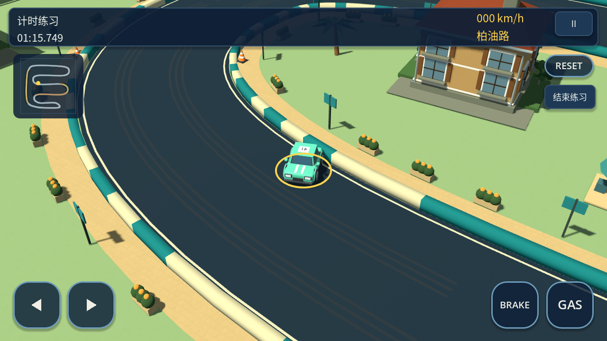
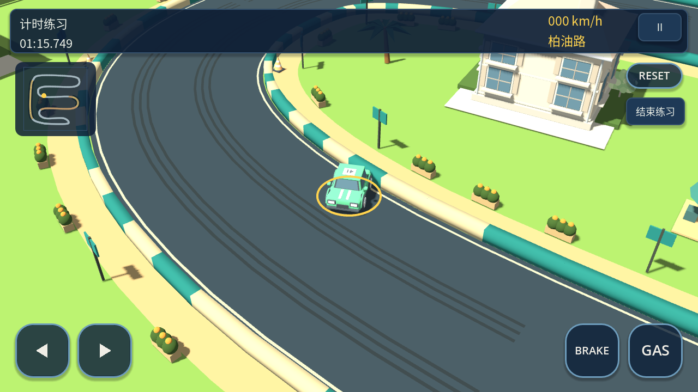

# 模型风格：original / bright_clay

默认保持 `original`。新增 `bright_clay` 为独立的明亮哑光黏土资源版本，应用和玩法仍为同一套，不增加风格切换 UI。旧 GLB、既有发布和标签不改动。

| 原版 | 明亮黏土 |
| --- | --- |
|  |  |

两图为 Godot 4.7 同位置、同相机实际渲染，已逐张查看。这两张是初版 28 模型阶段的截图；当时原版与基线逐像素相同。后续两风格同步新增场景，见 [新增布景](scenery-additions.md)。黏土版降低金属/高光、提高粗糙度，保留车色、深色路面、轮胎与玻璃辨识度；道路/建筑/植被使用简洁的柔和材质。它沿用已有圆角轮廓，没有新增圆角拓扑或更改比例。

## 资源及节点契约

- 原版仍在 `assets/models/`；新 GLB 位于 `assets/styles/bright_clay/models/`，对应全部 37 个原始 GLB：原有 28 个，加上两风格同步新增的 9 个地标与植被模型。
- 新 GLB 是独立文件，材质/配色确实写入文件，不是改文案或运行时统一覆盖旧资产。原版所有文件内容不变。
- `tools/build_bright_clay.py` 可重建黏土 GLB 和清单。它只改 glTF 材质 JSON，保持二进制几何块、节点、变换、网格、动画/蒙皮数据不变。车辆仍有同名四个 Wheel 枢轴；三角形数量、AABB、朝向、碰撞及轮子动画逻辑保持不变。
- 程序生成的地面、路缘及街区物件也接入风格材质；黏土版不加载被过滤掉的原表面纹理。未重做 UI，没有改驾驶、转向或物理插值规则。

## 开发与打包

桌面开发（Godot 编辑器二进制运行工程）：

```sh
godot --path .                                  # 未设置变量时为 original
MICRO_APEX_MODEL_STYLE=bright_clay godot --path .
```

环境变量只在未锁定的开发配置中生效。非法值明确报错并退出，不静默切回其它风格；进程启动后风格固定，不提供热切换。

GitHub Actions 的 **Build Android APK** 新增 `model_style` 下拉值 `original` / `bright_clay`，默认 `original`。该选择显式赋给 `MICRO_APEX_MODEL_STYLE`，运行 `prepare_model_style.py --from-environment`，写入包内 `config/model_style.json`，设置 `locked=true` 并记录模型列表。导出时只保留所选模型。

**CI 的进程环境变量不会继承到安装后的 APK。** Android 从包内配置识别风格；锁定配置也不会被桌面或设备的相反/非法环境变量覆盖。Android 运行路径不依赖设备 shell 变量。导出模板同样忽略开发环境变量。

本地候选 APK 构建：

```sh
bash tools/build_android.sh                 # 固定默认 original，忽略开发者的同名环境变量
bash tools/build_android.sh bright_clay
```

该脚本显式选择风格，导出期间锁定配置，退出后恢复开发配置和导出预设。缺少资源或非法值会停止。默认原版预设始终过滤黏土目录；黏土包过滤原模型和未使用的表面纹理，不把两套模型都塞进安装包。没有修改包 ID、签名或版本号；将来发布仍需按正常规则递增版本码，同包 ID 的两种外观并非并排安装的独立应用。

## 验证与发布元数据

```sh
python3 -m unittest discover -s tests -p 'test_*.py'
python3 tools/validate.py --godot godot
MICRO_APEX_MODEL_STYLE=bright_clay python3 tools/validate.py --godot godot
python3 tools/verify_model_style_exports.py --godot godot
```

最后一条仅在本地导出两份 Android **资源 PCK**，不是构建 APK，也不调用远端服务。它恢复工作区配置，验证包内锁定风格、所选模型目录中全部模型加载、未选资源缺失，以及相反/非法环境变量均无法改变风格。完整场景探针还验证了两种包中六条赛道的资源加载。

Android CI 校验器的 `--expected-model-style` 核对实际 APK 内的配置、模型覆盖及资源过滤。artifact 和 Release 新增 `model-style.json`；发布器要求它与实际 APK 中的锁定配置一致，发布说明需标明风格。已有不含风格配置的四文件 artifact 仍按旧流程兼容，不能给新风格包悄悄省略元数据。附件仍必须通过 GitHub Actions runner 发布，权限与凭据不变，见 [Android 发布流程](android-build.md)。

## 初版 28 模型阶段验证记录（历史数据）

- 两种风格完整标准回归均通过，包括模型契约 467 项、碰撞停车转向 465 项、输入链 412 项、转向专项 8910 项、物理插值 11 项，以及每种风格三场自动比赛。
- 两份真实资源 PCK 各 28 个模型全部加载，相反和非法环境变量的六组运行检查通过；两风格六赛道共 12 次包内场景启动通过。
- 原始 GLB 合计 16,165,684 bytes，新 GLB 合计 16,161,448 bytes；二进制几何块完全一致。资源包约为原版 65.55 MB、黏土版 24.70 MB，后者主要减少了表面纹理；这些数字不含 Android native 模板，不能当作 APK 大小。
- 相同小样场景的软件 OpenGL 计数均为 882 次绘制、659,470 个图元；纹理显存计数约 88.87 MB → 32.94 MB，总视频内存计数约 103.26 MB → 47.34 MB。仅作桌面代理检查，不代表 Android FPS、耗电或热表现。
- 没有 Android 真机。本阶段未推送、触发 Actions、构建或发布新 APK。Library 图片保存辅助流程遇到工具发现 HTTP 401，未创建 Library 文件；截图原件保留在本地及此文档中，没有伪造文件 ID。
