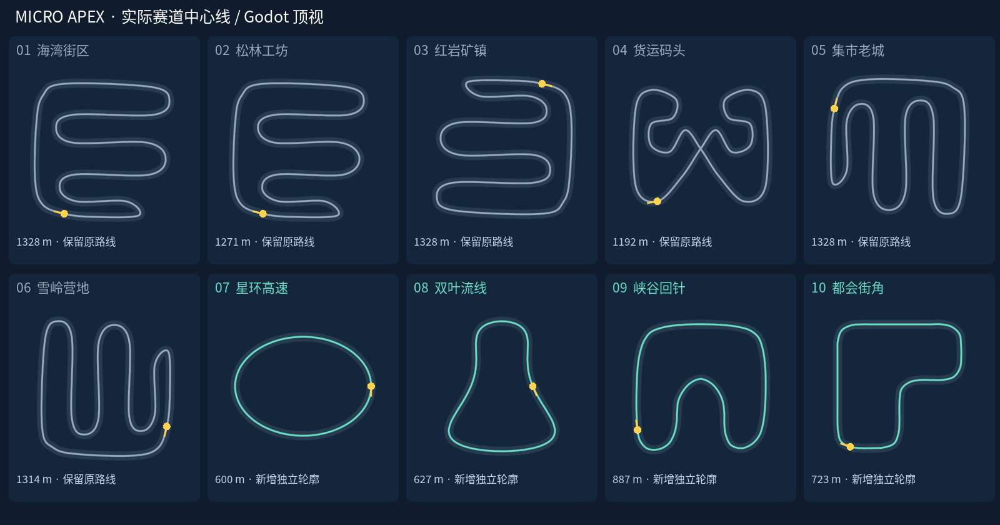
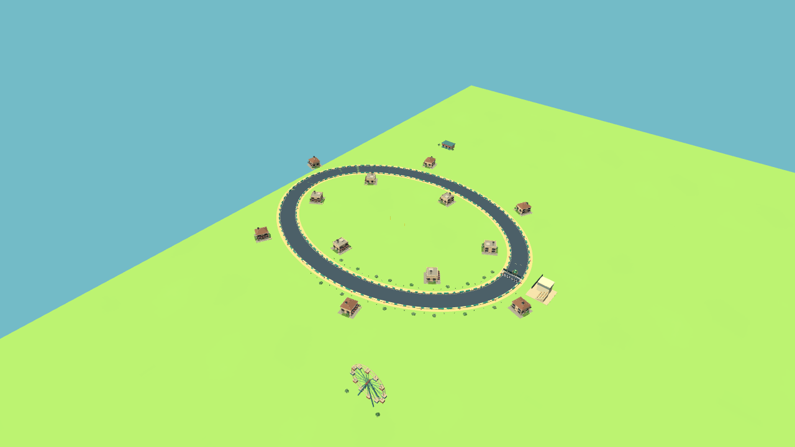
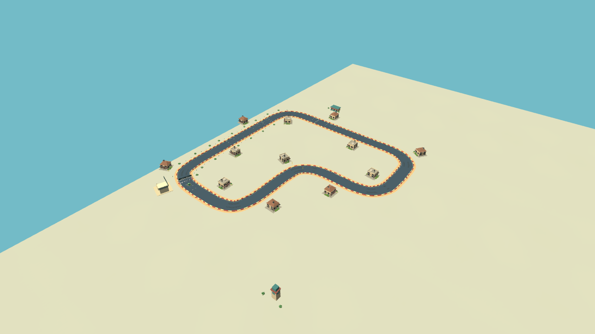

# 新增独立路线轮廓

基线为 0.13.10 / `ee16b69`，本次为 0.13.11 / code 30 候选；发布状态以对应 GitHub Actions 与 Release 为准。原版、手捏黏土与折纸共用同一赛道几何和操控，三套各 37 模型保持不变。

## 根因与真实对照

旧六条中，海湾、松林、红岩、老城、雪岭都基于 21 控制点梳齿模板：红岩为海湾旋转 180°，老城旋转 90°，雪岭再做镜像/轻微缩放；松林主要调整折返宽度。货运码头是例外，使用有立交的交叉轮廓。仅换场景无法满足路线种类要求。

该图由 Godot 4.7 根据实际 `Track.points` 绘制，包含起点、行驶方向和长度；不是概念生成图。灰色六条保持，绿色四条新增。

| 编号 / 内部 ID | 名称 | 长度 | 核心区别 |
| --- | --- | ---: | --- |
| 07 / 6 | 星环高速 | 600 m | 连续高速椭圆、长弧线、纯柏油，无内折返 |
| 08 / 7 | 双叶流线 | 627 m | 非对称双湾与 S 形曲率换向，连续转弯衔接，纯柏油 |
| 09 / 8 | 峡谷回针 | 887 m | 单一深发卡、外圈再加速、出口红土；不增加垂直物理 |
| 10 / 9 | 都会街角 | 723 m | L 形城市轮廓，六个圆角直角弯，短直道反复制动/加速 |

初稿城市控制点间距不均造成样条曲率尖峰；改为均匀弧长控制点。S 湾和发卡也经圆滑重排，保留独立轮廓，不改全局插值或车辆转向半径。当前密集几何检查的最小半径约 13–47 m，超过最宽转向车辆半径、半路宽及余量；非相邻道路间距至少约 32 m。

| 纸模椭圆实际 3D 渲染 | 纸模城市实际 3D 渲染 |
| --- | --- |
|  |  |

更多实际场景：[S 湾](screenshots/route-new-flow-paper.png)、[发卡](screenshots/route-new-hairpin-paper.png)。

## 集成与兼容

- 只追加 ID 6–9。旧 ID 0–5 的定义与采样几何按旧提交快照检查，36 个生涯事件、解锁门槛、奖励/目标和星级保持不变。
- 新路线与既有自由赛道同样直接开放，使用已拥有车辆。自由竞速、反向、练习、记录及小地图复用现有系统，不增加生涯进度迁移。
- 选择页自动生成四组分页，新增路线显示节奏说明；真实触摸测试覆盖低横屏高度下的最后一页、滑到底和启动第十条路线。
- 检查点仍为 24 个，必须依序前向通过。复位沿最后合法检查点重置位置/朝向，清速度并使当前圈无效。新旧正反向记录分键保存，钱包和旧星级保留。
- 游戏既有车辆贴合路径高度、护栏负责实体碰撞；本轮没有新增重力/地面垂直物理。所有新路线为平面闭环，无交叉或高架。

## 布景与成本

新增路线有独立 `scenery_index`，只选择既有美术调色与地标；物理和计圈仍使用真实赛道 ID。土路周围的地面使用独立浅石色，避免工艺风格的统一泥土着色掩盖驾驶路面。每条最多 12 个建筑候选、2 个地标、48 个灌草点，并沿路做完整包围半径避让。没有复用旧城区的高密度填充网格，也没有增加模型种类。

相同远景相机、同画质的 Linux 软件 OpenGL 代理计数：纸模四条新增路线为 389–425 draw calls、426,090–531,016 图元、约 25.54 MB 纹理计数；旧纸模海湾压力视角为 1487 calls / 978,734 图元。新路线未增加既有压力峰值；这些不是 Android FPS、功耗或温升结果。

## 验证及范围

- `route_variety.gd`：64 组（8 车型 × 4 新路线 × 正反向）AI 完整圈，所有 24 门顺序通过；道路间距、曲率、禁止跳终点。
- `route_flow.gd`：8 场真实六车正反向完整比赛、检查点复位及圈无效规则。
- `route_boundaries.gd`：每种风格 768 项，所有门两侧的实体护栏存在、宽度一致，覆盖正反向。
- `route_compatibility.gd`：每种风格 52 项旧几何、生涯快照及存档互不覆盖检查。
- 三份本地 Android 资源 PCK 保持 37 模型、风格锁定/排他，实际启动全部 10 条赛道。不是 APK 构建，也没有触发远端 Actions。

旧测试的“场地 72% 距道路不超过 20 m”和“圈长 1000–1400 m”偏向密集折返。原六条仍保留原阈值；新路线采用独立短圈范围 550–1000 m，并保留道路不重叠检查、增加曲率和实车完整圈检查，没有为了测试修改驾驶手感。首次长度规则失败日志保留在 `build/validation/routes/first-attempt-full-*.log`。

最终三风格完整回归全部正常退出，每套 27 个 suite（旧 23 个加新增 4 个），合计 81 个 suite。每套新增：768 项护栏、52 项兼容、152 项几何/64 AI 圈、8 场六车比赛；手机触摸布局 566、运动转向 3106、碰撞转向 736、模型契约 2669、插值 11、道路撞击 194、相机 8670 等检查通过，旧三场扩展赛也通过。Python 36 项通过。可选长期 `--balance` 未运行。

本地 Android 资源 PCK 为 original 64,805,664 bytes、bright_clay 28,346,224 bytes、paper_craft 29,499,880 bytes；12 组环境隔离与 30 次包内赛道启动通过。不是 APK 大小。三套完整矩阵共用一次已成功的导入，使用独立日志目录和独立用户数据目录并行运行；标准验证默认仍执行导入，不跳过任何游戏 suite。本地日志和真实 PNG 在 `build/validation/routes/` 与 `build/validation/scenery/`。Library 先前 401 流程未重试；本页截图随本地源码提交，不将工具展示当作会话图片交付。没有 Android 真机，真机表现和持续帧率待验收。
