# 橡皮泥版高饱和配色

基于 0.13.13，仅修改 `bright_clay` 模型与场景色调。纳入 0.13.14 橡皮泥 Android 测试发布；`original` 与 `paper_craft` 本轮不修改。paper 的厚纸板模型需求需在本轮橡皮泥配色确认后另外处理。

## 改了什么

旧生成器对色差较大的颜料统一乘 0.72；场景运行时又向米白混合，草地固定为低饱和绿。新方案直接给 37 个已有模型写入鲜亮颜料：

| 用途 | sRGB 参考颜料 |
| --- | --- |
| 红色车身、珊瑚建筑 | `#FF574F` |
| 蓝色车身、摩天轮支架与屋顶 | `#28BDF4` |
| 黄色车身、花朵 | `#FFD21F` |
| 叶簇、灌木 | `#55D936`，并保留分层深浅绿 |
| 均衡车、敞篷车、肌肉车 | `#22CF88`、`#31DDE8`、`#B34FFF` |
| 大片草地 | `#64BD45`，根据实际灯光校准，避免第一版局部荧光剪裁 |
| 路面、玻璃、轮胎 | 深蓝灰、深青、炭黑，保留驾驶对比 |

中性白色标线与深色细节不强行提亮；场景色调不再统一加米白，彩色路缘、建筑和植被增加饱和度。UI 的奶油底、按钮、文字颜色不在本轮修改范围。

修改的是材质与顶点颜料，不是通过增加曝光或灯光制造“鲜亮”：太阳能量、环境光、色调映射、相机和摆放全部维持原值。模型仍用原有高粗糙度、低高光、不透明材质和共享指印法线；没有添加材质、贴图、碰撞、节点或几何。

色卡值是作者输入，不等于最终屏幕像素：脚本将模型 sRGB 色卡转换为线性 `COLOR_0` 数值，保留既有 2.5% 局部起伏；运行时地表继续使用既有转换路径，纸模分支原样保留。着色和光照还会改变明暗。参见 Godot [颜色与着色器提示](https://docs.godotengine.org/en/stable/tutorials/shaders/shader_reference/shading_language.html#using-source-color)。未调整全局色彩管理或渲染后端。

## 实际前后渲染

Godot 4.7 / Linux Mesa llvmpipe 软件 OpenGL，1280×720，固定同一相机、太阳、环境光、车辆与场景。以下全部是真实 Godot 渲染，不是概念图或 Android 真机截图。

| 场景 | 修改前 | 修改后 |
| --- | --- | --- |
| 八车、树、建筑和摩天轮 | 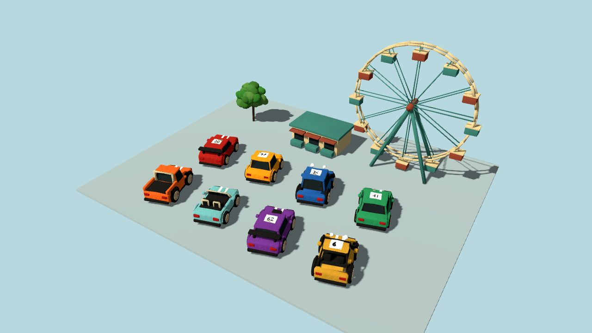 | 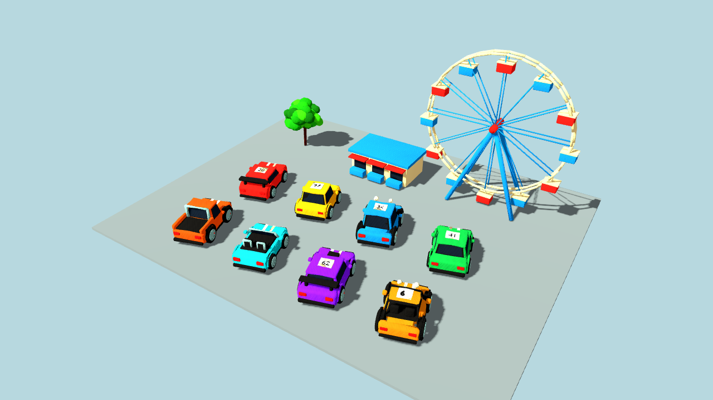 |
| 近景橡皮泥纹理 | 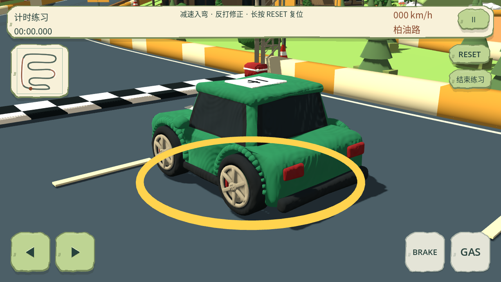 | 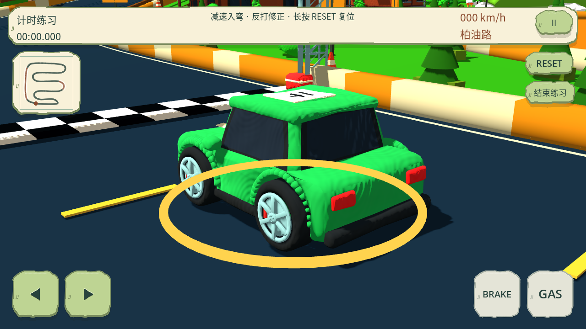 |
| 海湾街区 | 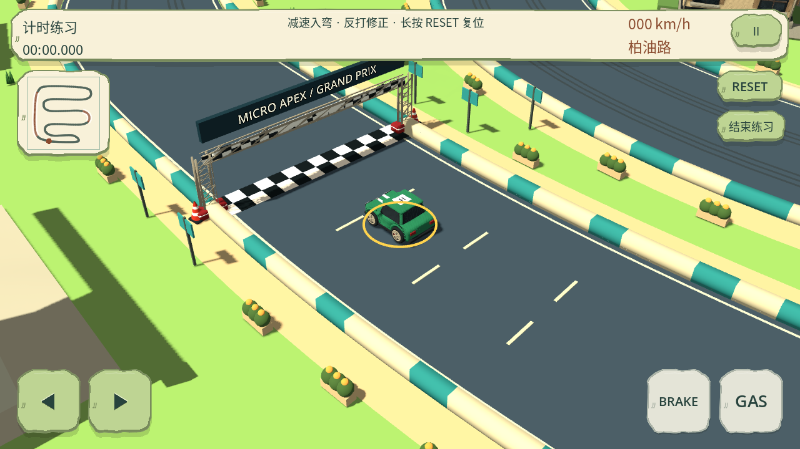 | 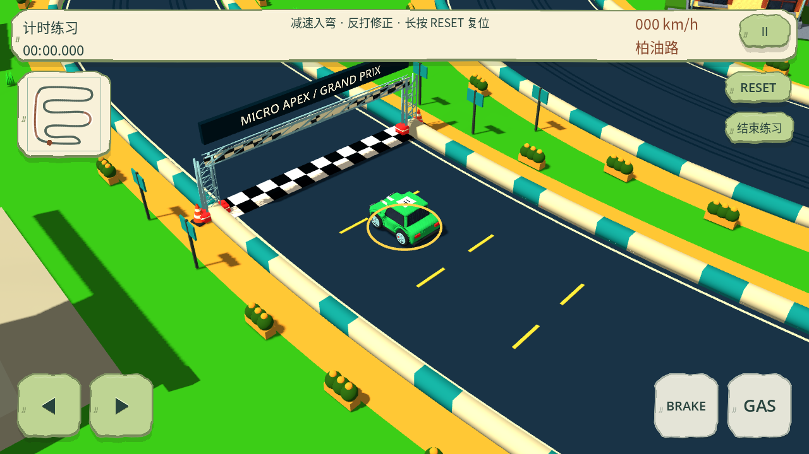 |
| 松林工坊 | 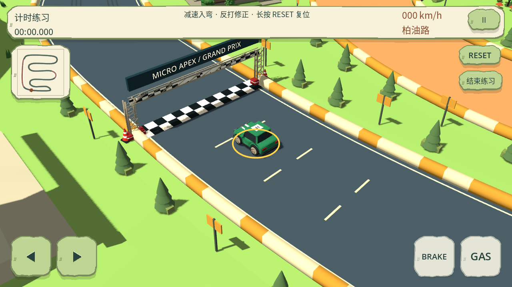 | 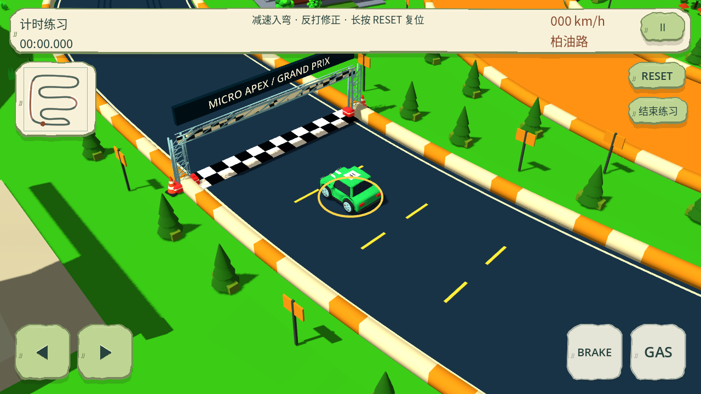 |
| 红岩矿镇 | 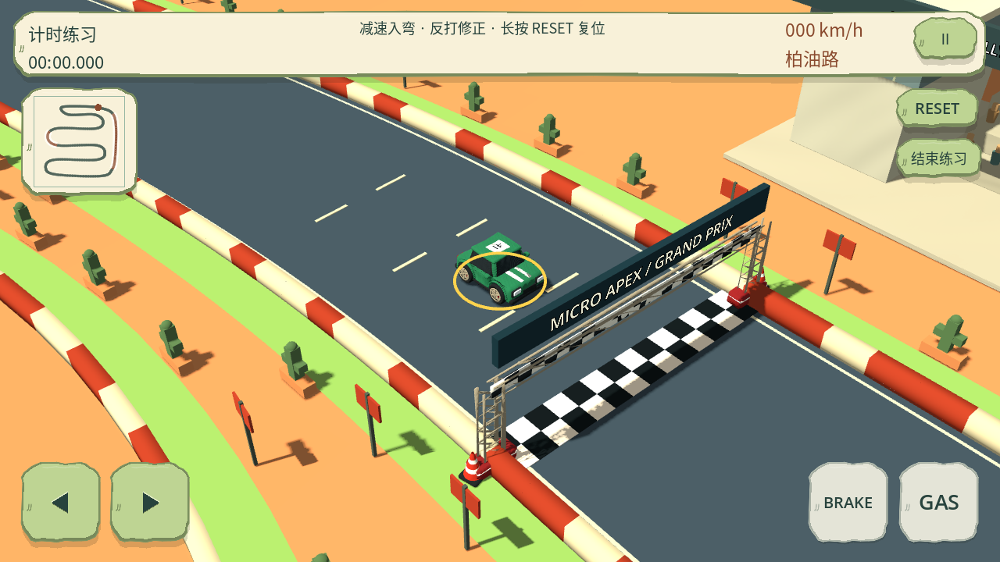 | 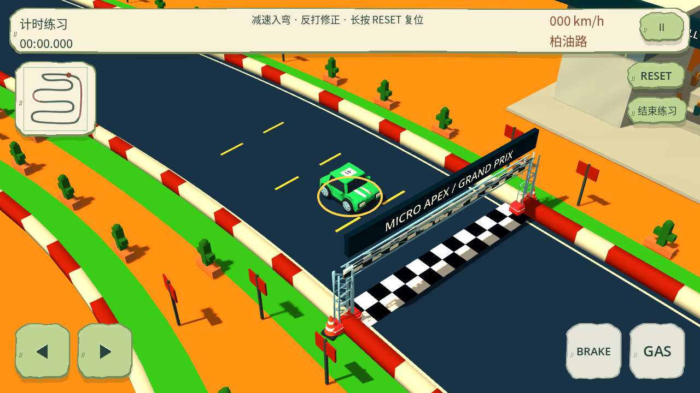 |
| 雪岭营地 | 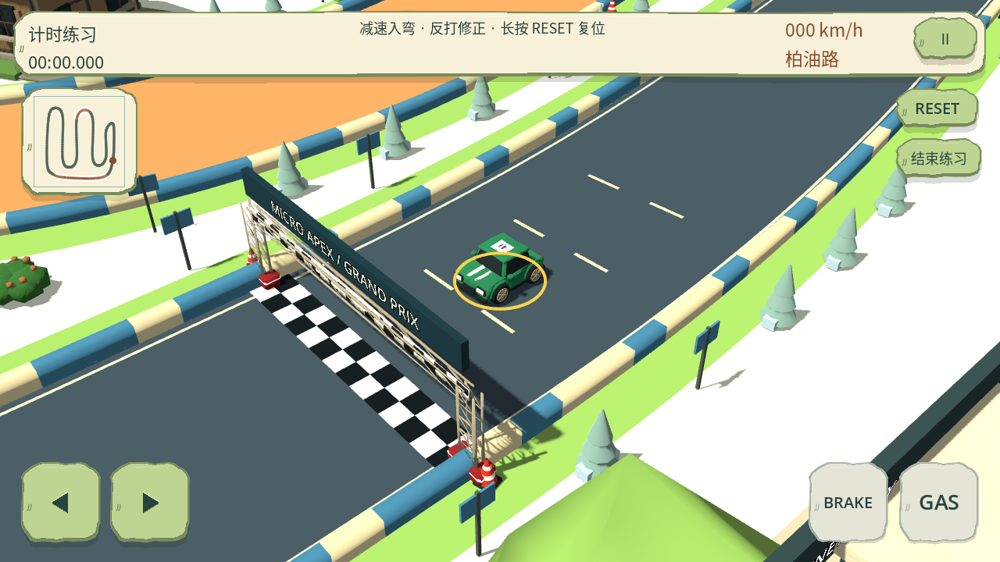 | 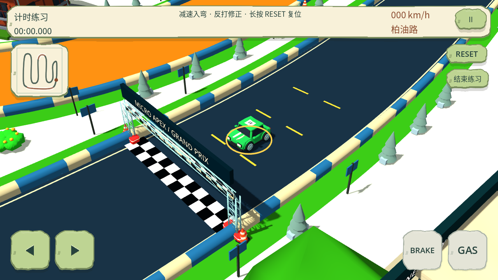 |

所有三风格 42 张原始 PNG 在 `build/validation/clay-palette/`；各包含模型组、近景、四场景及车库。使用 `MICRO_APEX_MODEL_STYLE=bright_clay godot --path . --script res://tools/render_clay_palette.gd -- after` 可重拍。

## 隔离与成本

- 原版／纸模的 156 个资源文件哈希未变；两套各 7 张前后图逐像素一致（共 14 张）。本轮没有制作或修改 paper 模型。
- `recolor_clay_models.py` 从固定基线 `e6209b8` 读取旧黏土 GLB，按旧颜料及微小局部起伏重新映射颜色；仅改现有 `COLOR_0` 三通道与生成器说明。37 个模型的其他二进制缓冲逐字节保持，manifest 保存非颜色缓冲校验。节点、位置、法线、UV、枢轴、层级和面数均不重建。
- 常规 Blender 生成器也使用同一新色表，避免以后重建退回柔和配色。固定基线的重着色脚本需要 Git 中存在该历史对象；不自动下载或修改历史。
- 同相机 draw calls 全部相同。远景图元因 Godot 重新导入的 LOD 选择有小幅变化：模型组 409142→409604（+0.113%），森林 494674→494122，雪景 617602→617812；其他采样场景相同。源网格未变；这些是桌面代理计数，不是 Android 帧率、温升或功耗测试。

## 验证与限制

Python 42 项通过，包括实际 37 个 GLB 的非颜色缓冲、八车颜料、色卡转换、暗色对比、完整模型清单与签名／构建工具测试。新增运行时专项验证风格隔离、地表选择、中性标记、暗部和灯光不变。三套完整回归各 31 个 suite 正常退出（合计 93 个）；既有转向、碰撞、插值、倒计时／震动和移动 UI 回归通过。最终草地标定另补跑橡皮泥专项 8 项通过。三份 PCK 各 37 模型、12 组环境隔离、30 次赛道初始化通过；封包内新配色专项 8 项通过。PCK 字节数为 original 65,820,656、bright_clay 29,415,488、paper_craft 30,514,888，不能称为 APK 大小。可选长期 `--balance` 未运行。

首轮专项暴露暗色也被提亮的问题，已增加低明度保护；原版测试改为验证其原有纹理 tint 路径，未将其改成工艺地表。最终色彩标定另补跑橡皮泥专项。导入与截图无脚本／渲染错误，渲染器退出有既有 ObjectDB 清理警告。

没有 Android 真机，未验证手机色彩模式、阳光下可读性或实际移动性能。工具图片查看不等于已向主会话交付附件；真实 PNG 与可审查文档随本次源码推送到 GitHub，未重试旧 Library 401／artifact 403。
