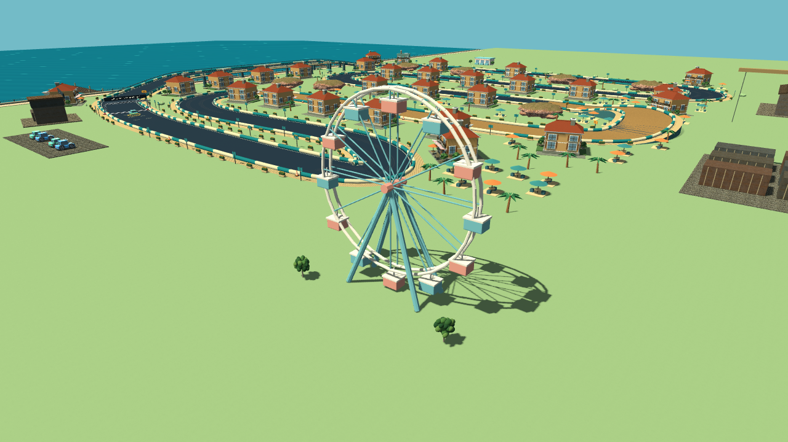
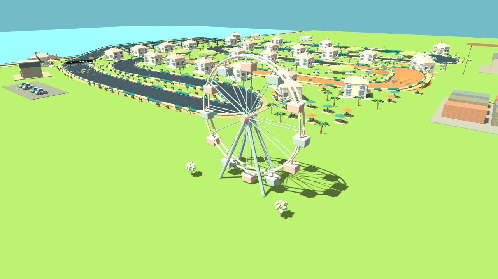
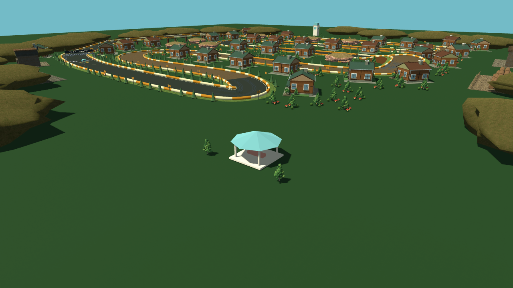
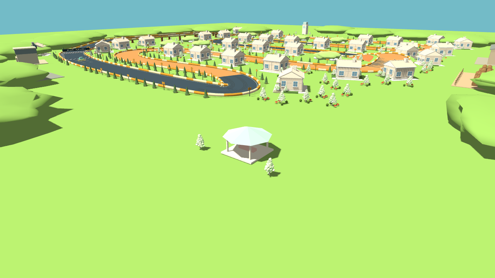
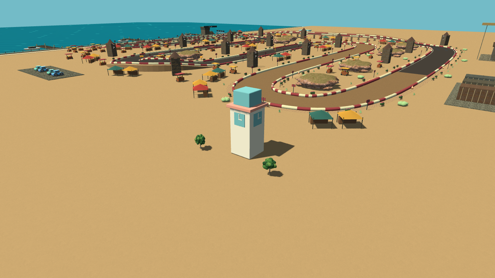
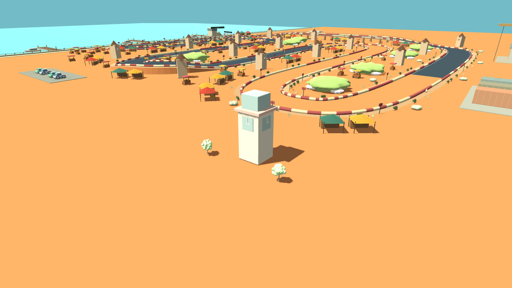

# 同步地标与植被扩充

original 与 bright_clay 同步增加 9 个语义相同的模型，两套目录现在各 37 个 GLB。原有 28 个文件保持原字节，新增资源沿用米制、Y-up 导出和同名节点契约。original 使用较沉稳的绿、陶红和米色；bright_clay 使用更明亮的哑光配色。

| 模型 key（文件名为 key + `.glb`） | 内容 | 三角形 |
| --- | --- | ---: |
| prop_ferris_wheel | 静态摩天轮，12 个吊舱、双轮圈与支架 | 5532 |
| prop_clock_tower | 四面实体时针钟楼 | 1620 |
| prop_market_hall | 三摊位市场大厅 | 1188 |
| prop_pavilion | 八角顶开放凉亭 | 342 |
| foliage_leaf_cluster | 七团低面数叶簇 | 140 |
| foliage_shrub_round | 圆形灌木 | 100 |
| foliage_shrub_flower | 带不透明花朵的灌木 | 240 |
| foliage_grass_green | 绿色草簇 | 54 |
| foliage_grass_dry | 枯黄草簇 | 54 |

新增 original GLB 合计 631,244 bytes，bright_clay 合计 632,912 bytes。没有贴图、透明叶片、动画、碰撞体或每帧脚本。叶簇附加到原树模型上，不覆盖旧模型。摩天轮不旋转，保持有限的场景成本。

## 六赛道摆放

| 赛道 | 第一地标 | 第二地标 | 草簇 |
| --- | --- | --- | --- |
| 海湾街区 | 摩天轮 | 市场大厅 | 绿色 |
| 松林工坊 | 凉亭 | 钟楼 | 绿色 |
| 红岩矿镇 | 市场大厅 | 钟楼 | 枯黄 |
| 货运码头 | 摩天轮 | 凉亭 | 绿色 |
| 集市老城 | 钟楼 | 市场大厅 | 绿色 |
| 雪岭营地 | 凉亭 | 钟楼 | 枯黄 |

地标位于外缘园地，首选坐标 `(94,143)` 与 `(-45,-145)`；若将来路线占用则沿外侧寻找空位。摩天轮保留 16 米半径，其他建筑含园地保留 12 米半径；每处园地带两棵树。地标在其它地块生成前预约位置，保留现有的道路净空与地块互斥规则。松林和雪岭的外圈背景山丘避开地标园地，防止模型被埋入山体；不修改道路地形或碰撞。

每条赛道另加入 48 组灌木/草簇，灌木约占三分之一；沿低海拔路段两侧抽样，仅在空闲地块布置，不在桥面上生成。灌木预约 2.4 米半径，草簇预约 0.8 米半径。原有树木附加两个叶簇，园地树同样处理；两套风格使用同一布置代码；新增灌木/草簇采样不消费原有随机数序列。

重复网格接入现有的按材质、网格和 48 米空间格划分的 MultiMesh 批处理。沿用质量开关：低画质隐藏装饰，不影响道路和车辆。此次不修改赛道路径、碰撞、操控或物理插值。

## 重建与验证

```sh
blender -b --python tools/build_scenery_additions.py
python3 tools/build_bright_clay.py
python3 -m unittest discover -s tests -p 'test_*.py'
python3 tools/validate.py --godot godot
MICRO_APEX_MODEL_STYLE=bright_clay python3 tools/validate.py --godot godot
python3 tools/verify_model_style_exports.py --godot godot
```

准备脚本要求两套目录文件名完全匹配，风格配置从实际目录收集完整模型列表，没有固定为 28 或 37。打包时仍排除未选风格。模型契约测试比较所有模型；新增专项检查六赛道地标数量、植被预算、完整占地、起点净空、不透明材质与低画质开关。包内探针检查实际载入的新布景，避免模型虽入包却未使用。

真实截图、增添前后固定相机渲染计数和测试日志位于 `build/validation/scenery/`。可重拍无 UI 的场景小样：

```sh
mkdir -p build/validation/scenery
MICRO_APEX_MODEL_STYLE=bright_clay godot --path . --script tools/render_scenery_samples.gd --audio-driver Dummy -- sample-bright-clay-0 0 detail
```

截图为本地文件，不能把工具中显示图片视为已向用户交付。此轮不上传图片、不推送、不触发远端构建或 Release。无 Android 真机，桌面软件 OpenGL 的计数不能代表手机帧率、温度或耗电。

## 实际渲染小样

以下为 Godot 4.7 / Mesa llvmpipe 的工程内真实渲染，固定相机并隐藏测试截图中的 HUD；不是概念图。

| original | bright_clay |
| --- | --- |
|  |  |
|  |  |
|  |  |

## 固定相机渲染开销代理

1280×720、质量 1、同位置增添前后；两套风格几何和绘制计数一致。下表来自带相同 HUD 的另组截图，避免无 UI 小样对计数造成偏差。

| 视角 | 绘制调用前 → 后 | 变化 | 图元前 → 后 |
| --- | ---: | ---: | ---: |
| 海湾总览 | 1633 → 1716 | +5.08% | 774836 → 752710 |
| 海湾地标近景 | 1976 → 2092 | +5.87% | 1041906 → 1056690 |
| 松林总览 | 1598 → 1682 | +5.26% | 685468 → 685088 |
| 老城总览 | 1373 → 1443 | +5.10% | 431522 → 402682 |

各组纹理内存计数不变。部分视角图元减少，是新增预约地块改变了旧装饰的填充位置和数量，不能解读为整体性能优化。没有测 Android FPS；此处只确认新增内容未引入透明叶片或新纹理开销，并量化有限的绘制增量。

## 本轮验证结果

- Godot 4.7 stable（5b4e0cb0f）；两风格完整标准回归成功，含既有碰撞停车转向、输入链、物理插值、相机、六赛道及三场自动比赛。
- 模型契约 542 项、新布景专项每风格 671 项、Python 32 项通过。随后针对背景山丘净空调整，再跑两风格布景、地块和相机专项均通过；摆放报告逐项一致。
- 两份真实 Android 资源 PCK 分别为 original 65,799,584 bytes、bright_clay 24,951,316 bytes。每份 37 模型加载，六组环境隔离检查和 12 次包内赛道启动通过；包内场景探针确认新地标、草木与叶簇实际存在。
- 原有 28 个模型及其 28 个黏土变体，均与本轮前文件逐字节一致。
- PCK 不含 Android native 模板，不能当作 APK 大小；本轮没有构建 APK 或手机实测，没有推送和发布。
