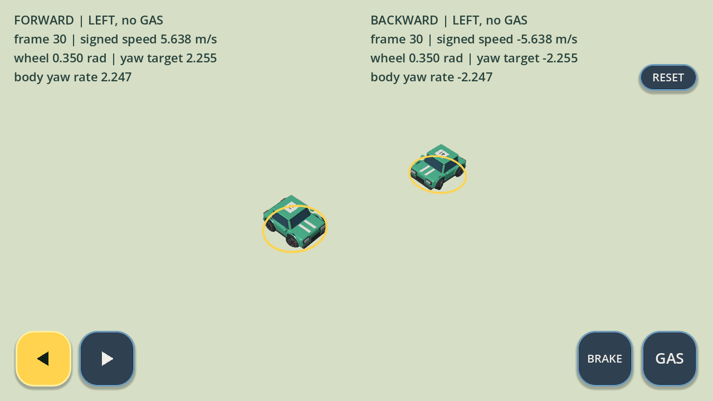
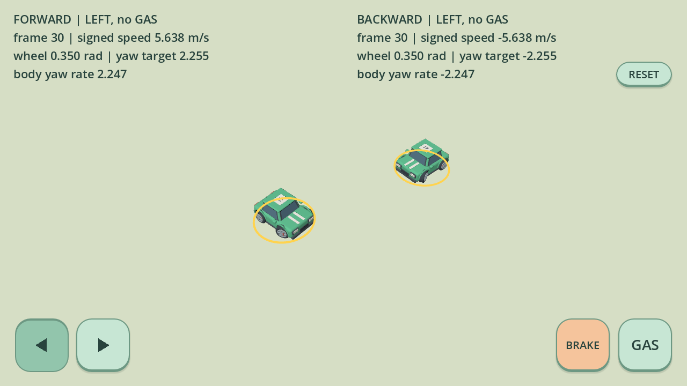

# 按实际前进/后退统一转向（本地待发布）

基线为已发布 0.13.7 源码 `37d48b72b2bc7fea1f8caad9732e5652043eb837`。此次按用户的新要求替换旧的“倒车也让车头跟随箭头”语义，不再根据碰撞状态清零转向。尚未推送、构建 APK 或在 Android 真机验收。

## 控制规则

左右按钮控制前轮相对车身的轮角。实际速度向量在车头前向轴的投影 `u = velocity.dot(forward)` 决定车身转向关系；屏幕朝向、GAS、倒车驱动标记和碰撞标记均不参与正负判定。

| 实际运动 | 左按钮 | 右按钮 |
| --- | --- | --- |
| 前进，u > 0.1 m/s | 轮向左，车头向自身左转 | 轮向右，车头向自身右转 |
| 后退，u < −0.1 m/s | 轮向左，车头向自身右转 | 轮向右，车头向自身左转 |
| 静止/低速，|u| ≤ 0.1 m/s | 新转向角速度目标为零 | 新转向角速度目标为零 |

0.1 m/s 即 0.36 km/h，死区对称，没有“记住前进方向”的锁定；持续 −0.2 m/s 后退即按倒车关系转向。死区只抑制极小跨零噪声产生的新转向，不清除真实负速度或已有角速度。碰撞反弹只要形成实际后退，同样遵循后退关系，松 GAS 也如此。

原有轮角滤波（每秒 9 单位）、车身旋转响应（9/14）和抓地限制保持。刚松右按左时，平滑轮角可能仍向右；目标反向后，惯性角速度也可能暂时沿旧方向。这些量分开记录，不能把按钮、轮角、目标角速度和当前车身角速度当作同一量，也不能保证按键第一帧车头立即反向。BRAKE 停稳、松开再按以驱动倒车的操作保留；驱动档位只控制动力，不决定转向符号。

## 原因与最小修改

0.13.7 使用 `abs(longitudinal)` 请求转向，因此即使碰撞后确实后退，目标仍按前进关系计算；另有碰撞后时间/距离保护与硬停分支，会根据新按钮清零旧轮角/角速度。这与此次用户要求的实际前进/后退统一规则冲突。新方向测试在原实现上有 1,537/3,073 项失败，主要是 1,536 个倒车组合。

现在仅转向请求使用有符号纵向速度，经过上述死区后计算 `-steering * u / radius * gain`。纵向速度是在当前步动力/刹车/阻力积分之后、旋转及碰撞响应之前取得的实际前向分量；接触产生的负速度在该车随后一次动力学步参与判定（对手先推撞时可在同一帧的本车步生效）。移除碰撞恢复的角状态清零和此前硬停角状态清零；护栏速度投影、摩擦、硬停线速度归零、车辆推撞、碰撞体均未改动。

严格逐帧审计另发现 Godot `wrapf` 的近端点判断会吞掉朝下 ±π 附近的微小转角：初始 π、前速 0.2 m/s、右键首步，角速度 −0.001185717 rad/s，应旋转 −0.00001976195 rad，旧归一化却直接给出 −π。改为精确 `fmod` 余数归一化，保留 [−π, π) 范围和微小增量；没有按车头朝向硬编码转向反号。

## 时间序列证据

`motion_steering.gd` 的 car_speed，始终按右，前进刹停、松刹、再次 BRAKE 倒车，然后 GAS。单位分别为 m/s 和 rad/s：

| 60 Hz 帧 | 转向时实际纵速 | 平滑轮角输入 | 目标角速度 | 实际角速度 |
| --- | ---: | ---: | ---: | ---: |
| 0 | +2.6167 | +0.15 | −0.11775 | −0.01640 |
| 7 | 0 | +1 | 0 | −0.10628 |
| 51 | −0.08 | +1 | 0 | −0.00014 |
| 52 | −0.16 | +1 | +0.048 | +0.00987 |
| 110（已按 GAS） | −4.3367 | +1 | +1.3010 | +1.27236 |
| 122 | 0 | +1 | 0 | +0.52041 |
| 123 | +0.1333 | +1 | −0.04 | +0.40378 |

GAS 没有强行将仍在后退的车判为前进；最后一行目标已按前进反向，当前角速度按原惯性衰减。真实两车碰撞的第 7 帧，未按 GAS，车速被对手从 +0.23746 推至 −1.58890 m/s；动力积分后为 −1.57800，刚从左改按右的平滑轮角仍为 −0.85，目标角速度 −0.40239、实际角速度从 +0.06958 积分至 −0.02864 rad/s，碰撞法线为 (0.01103, 0, 0.999939)。这里分别可见真实反向运动、轮角滤波和旋转惯性，没有碰撞状态定向清零。完整墙碰、两/三车推撞记录包含这些量。

## 回归与复现

2026-10-24 本地结果：original 与 bright_clay 的完整验证均正常退出，全部通过；原版随后补跑的 1,302 项贴墙套件也全部通过，Python 33 项通过。

使用官方 Godot 4.7 stable（5b4e0cb0f）、Linux x86_64；物理 60 Hz。图形检查为 Xorg + Mesa llvmpipe Compatibility 软件渲染，不能代表 Android 帧率或触控硬件验收。

- 新运动规则：3,106 项；全部 8 车、三种路面、各朝向及 ±π、前后左右、GAS/BRAKE 组合、跨零、持续低速后退与噪声。
- 碰撞：736 项，350 个真实墙碰序列、64 个全部车型双/三车推撞序列；包括松 GAS、立即/延迟起步和持续 GAS。
- 截图位置附近真实赛道：1,302 项，1,296 个位置/朝向/速度/输入组合，检查真实碰撞及每步运动学，并保留原有低速脱困和前进擦墙检查。
- 方向：11,406 项，包含持续转圈与组合输入；实际键盘/触控链：412 项。
- 两种风格完整回归覆盖 37 模型、黏土 UI/原版 UI、插值、赛道与产品流程；Python 单元测试 33 项。

旧测试要求碰撞后立即消除反向转角，已随语义替换，保留真实接触夹具，并改为逐帧独立审计轮角滤波、速度符号、目标方向、角速度积分和车头角增量，不用强压角速度使断言通过。

```sh
MICRO_APEX_MODEL_STYLE=original python3 tools/validate.py --godot /path/to/godot-4.7
MICRO_APEX_MODEL_STYLE=bright_clay python3 tools/validate.py --godot /path/to/godot-4.7
python3 -m unittest discover -s tests -p 'test_*.py'
```

本地原始证据位于 `build/validation/signed-steering/`：双风格完整日志 `full-{style}.log`、各套件日志 `{style}-suite-logs/`、跨零序列 `transitions.json`。真实接触序列在 `build/validation/collision-steering/current-{style}.json`。字段 `speed_before_forces` 是步初速度，`steering_motion_speed` 是动力积分后用于转向的投影，`speed_after_collision` 是本步最终投影（纯 Dynamics 测试没有碰撞）；不能混用这些采样时刻。

## 实际渲染

`tools/render_motion_steering.gd` 通过真实触控左键及 RaceCar 渲染；两车初始同朝下，分别以 +6/−6 m/s 松油滑行，30 帧后速度 +5.638/−5.638，同轮角 +0.350 rad、目标角速度 +2.255/−2.255、车身角速度 +2.247/−2.247。两种风格可见相反的车身转向。未用概念图替代游戏画面。

原版：



黏土版：


