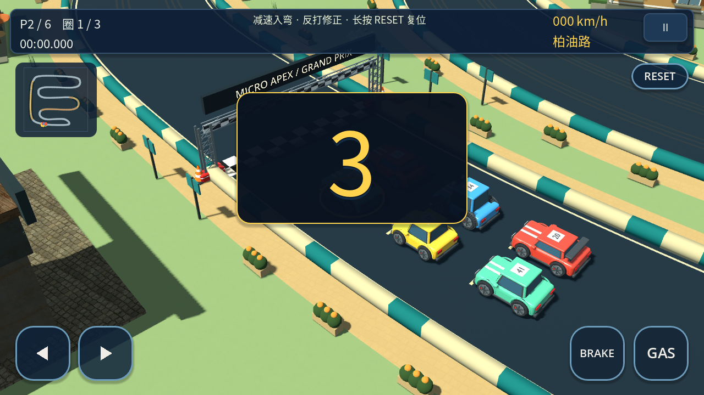
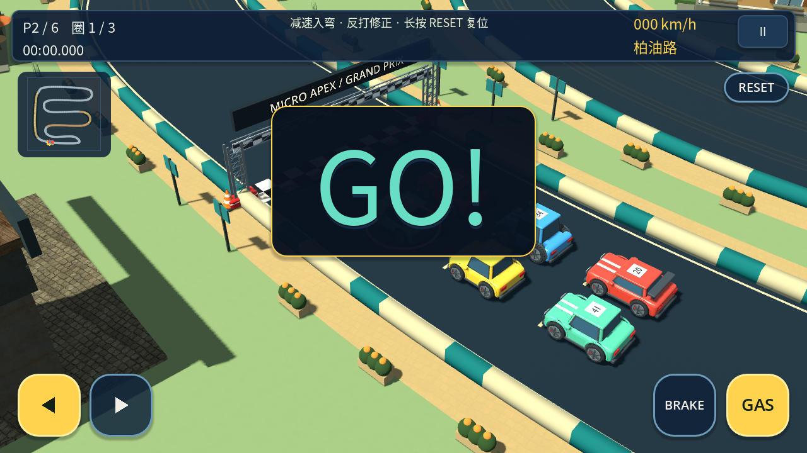
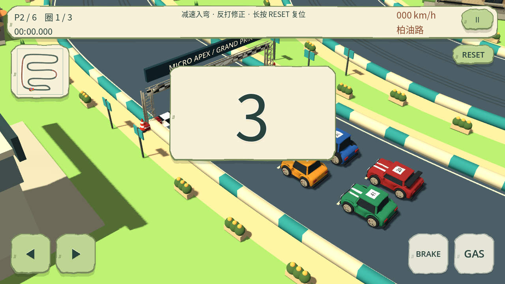
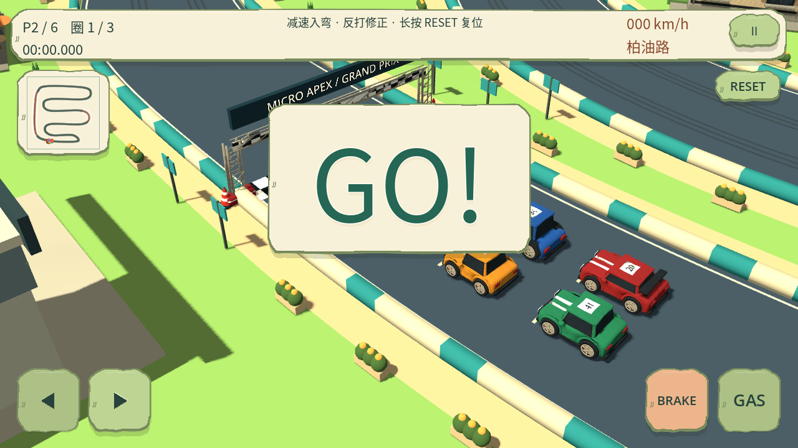
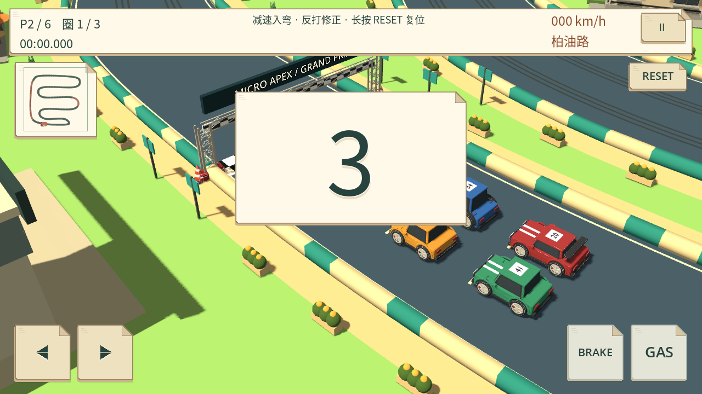
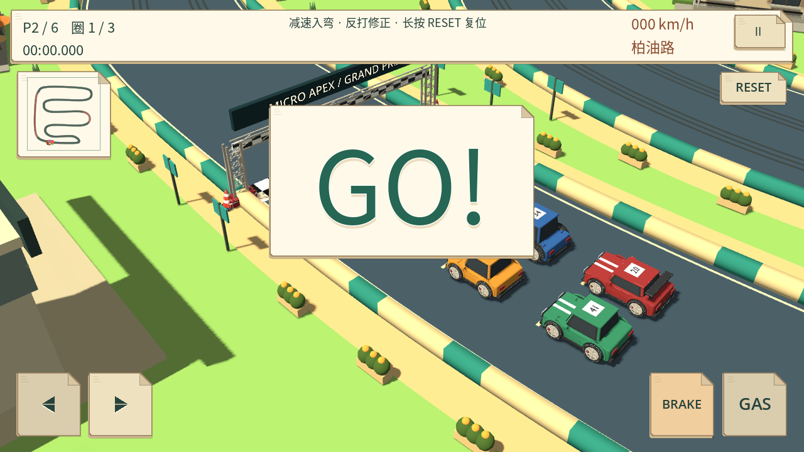

# 开赛倒计时可见性与电子音（本地候选）

基于 0.13.11，未推送、未构建或发布 APK。十条赛道、三套 37 模型及所有驾驶物理保持不变。

3 / 2 / 1 的基准字号从 100 增至 160，加 6 单位轮廓和背景承托；GO 使用绿色强调。原版深色金边，手捏版厚边，纸模版折角，均沿用集中主题。提示随安全区居中略上移，按可用宽高缩放，不接收鼠标/触摸，也不覆盖左右、GAS 或 BRAKE。GO 保留到比赛计时一秒后消失。

| 风格 | 3 | GO |
| --- | --- | --- |
| original |  |  |
| bright_clay |  |  |
| paper_craft |  |  |

截图为 Godot 4.7 / Linux 软件 OpenGL 的实际画面，不是概念图或 Android 真机截图。本地完整 3、2、1、按压与 GO 图在 `build/validation/start-cues/`。

## 原创音频与生命周期

- `assets/audio/countdown.wav`：0.16 秒、660 Hz 主音的短电子提示。
- `assets/audio/go.wav`：0.38 秒、880/1320 Hz 加上行扫频的复音起跑提示。
- 22,050 Hz 单声道 16 位 PCM；8 ms 起音、35 ms 收尾，无外部素材。`tools/build_start_audio.py` 可单独重建，主音频生成器也调用它，其他声音的合成算法不变。
- 数字更新和音频请求由同一个节拍切换函数提交；同一数字的重复帧不会重播，卡帧跳过的数字不集中补播。独立单实例播放器使菜单点击音不会截断倒计时；每次切换先停止旧提示，避免叠播。
- 遵循音效开关及主音量，额外衰减 8 dB。暂停、退出、重开和结算停止起跑声；恢复从 3 重启，修复旧计数未重置可能漏播首音的问题。
- 标准 headless 游戏回归沿用原有静音行为；专项显式启用 Dummy 音频播放器，检查实际 stream/playing 状态及切换。波形、频谱、起止包络和峰值检查不等于设备主观试听。

冻结车身和比赛时间、左右预摆、踏板反馈、跨 GO 持有输入的逻辑保持；原倒计时触控回归继续运行。

## 验证

专项 34 项覆盖初始音、3/2/1/GO 同步、重复帧、冻结、暂停/恢复、静音、零音量、重开/退出，以及宽屏/短横屏/平板下的安全区与触控避让。音频 PCM/频谱及所有 Python 检查共 38 项通过；三风格实际渲染已逐张核对。没有 Android 真机，设备响度、音频延迟和最终外观仍待验收。

三风格完整回归各 28 个 suite 正常结束（合计 84 个），包括十赛道、多车型、比赛、418 项原倒计时操作、566 项手机布局、转向和插值检查。完整矩阵启动时专项为 33 项；追加“仅一次节拍事件”断言及最终视觉位置后，三套分别补跑 34 项专项均通过，避让检查使用扩大后的实际 hit_areas。Python 38 项通过，可选长期 --balance 未运行。日志位于 build/validation/start-cues/，截图工具退出仍有原有的 ObjectDB 清理警告；运行中无脚本或渲染错误。未重试 Library 401 或 artifact 403；媒体保存在仓库与本地验证目录，不将工具图片输出称作会话附件交付。
